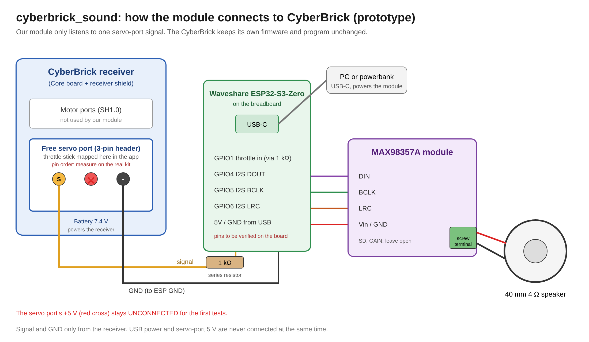

# cyberbrick_sound

Engine sound module for Bambu Lab CyberBrick RC. The module taps the throttle PWM signal from the receiver's servo port, plays a throttle-dependent engine sound through an I2S amplifier, and never interferes with the original signal.

## Status
Phase 1: prototype on a dev board (Waveshare ESP32-S3-Zero-N8R8-M + MAX98357A + 4 Ω speaker). A custom PCB comes only after the prototype works.

## Structure
- `firmware/` - PlatformIO (Arduino) project
- `docs/` - wiring, measurements, notes
- `3d/` - cases, links
- `hardware/` - KiCad, later

## Wiring overview

Stage 2 (powered from the CyberBrick servo port): `docs/wiring-stage2.png`.

Source: `docs/wiring-overview.svg`. Details and measurements: `docs/bringup.md`.

## Firmware plan
1. Test tone over I2S
2. Measure pulse width (50 Hz servo PWM) and print it to serial
3. Engine loop with smooth playback-rate change driven by throttle

## Sound samples
Originals and license: `assets/samples/` (see `LICENSE-SAMPLES.md`). The firmware embeds `firmware/include/engine_sample.h`, generated with:

    python tools/make_sample.py assets/samples/loop_2.wav firmware/include/engine_sample.h

## Building
Open the `firmware/` folder in VS Code with the PlatformIO extension, or run `pio run -e <env> -t upload` with `<env>` one of `test_tone`, `pulse_measure`, `engine`. See `docs/bringup.md`.
