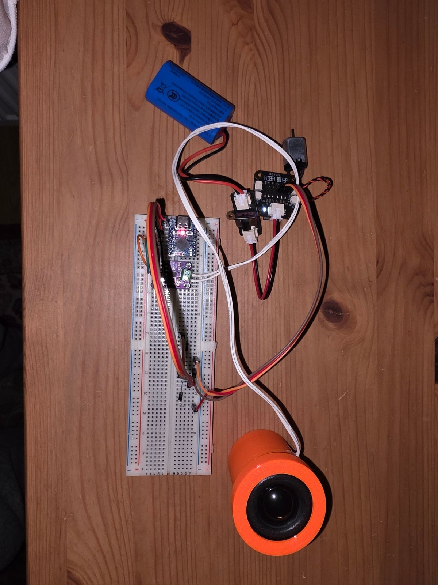
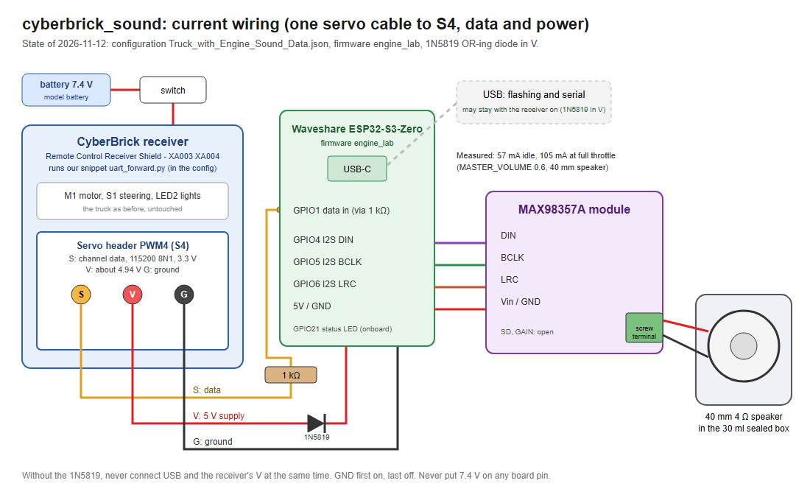

# cyberbrick_sound

Engine sound module for Bambu Lab CyberBrick RC models (first target: the truck). A small board hangs on one servo
cable from the CyberBrick receiver, gets all transmitter channels from it as serial data, and plays an engine sound
through an I2S amplifier and a speaker: idle, rpm following the throttle, a virtual gearbox, ignition with starter,
engine stop and horn. It never touches the original signal path: if the module fails, the model still drives.

## Status

State of 2026-11-08; what is still open: `docs/roadmap.md`.

- **Prototype works** on a breadboard in the truck: Waveshare ESP32-S3-Zero-N8R8-M, MAX98357A, 40 mm 4 Ohm speaker
  in a printed 30 ml sealed box, with a speaker EQ tuned for the box (2026-11-07).
- **Channel data link works** (2026-11-06): about 27 frames per second, no checksum errors; ignition, starter,
  stop and horn from the transmitter.
- **Gearbox effects** (2026-11-08): a shift sound on every upshift; reverse is detected from the stick and does not
  shift.
- **Shield PCB**: KiCad schematic, routed board and assembly files for JLCPCB and PCBWay exist (`hardware/shield/`);
  reviewed in KiCad by a colleague of the owner on 2026-11-12 (no remarks), quoted by both services, ordered at JLCPCB on 2026-11-13 (5 assembled boards), production file and parts placement confirmed on 2026-11-14, delivered on 2026-11-20 at 12:14 (photo of the five boards: SMD parts fitted, J1/J3/J4 not yet soldered; the owner calls them "rev. 0", in the repository they are rev A).
- Which engine sound wins is still being judged by ear (`engine_lab` holds all candidates).

## How it works

```
transmitter --radio--> receiver in the model --S4 servo header (S, V, G)--> sound module
```

| Where | What we added |
|---|---|
| Transmitter (CyberBrick Remote Control Transmitter Shield - XA003 XA005) | in the configuration only: the event that starts the receiver snippet by itself after power-up (moved centre of L2), and a long press of the L Shoulder Button to restart it |
| Receiver in the model (CyberBrick Remote Control Receiver Shield - XA003 XA004) | in the configuration only: our MicroPython snippet `uart_forward.py`, which sends all channels as serial data from servo header 4 (S4) to the module; the module also takes its power there |
| Sound module (ESP32-S3-Zero) | our firmware: reads the data on GPIO1 (through 1 kOhm) and makes the sound |

Bambu's firmware is unchanged on both boards. The configuration to send from the app:
`docs/cyberbrick-config/Truck_with_Engine_Sound_Data.json`. The firmware also still accepts the older variant, a
throttle-only servo pulse on PWM2. Details: `docs/controls.md`.

**Power rule:** USB and the receiver's 5 V may be connected together only through a diode in the V wire. The
breadboard prototype has a 1N5819 there since 2026-11-12 (measured: the receiver stays isolated from USB), and the
shield PCB has the OR-ing diode D2 (`docs/shield-pcb.md`). Without that diode, disconnect the V wire for flashing and
USB tests. Connect GND first and disconnect it last (`docs/bringup.md`).

## Documentation

Start with `docs/project-overview.md` (the whole project on one page) and `docs/roadmap.md` (everything still open).

**Using it: controls, wiring, configuration**

| File | What it covers |
|---|---|
| `docs/controls.md` | what we added where (transmitter, receiver, module), every transmitter control, ignition / starter / stop / horn, the receiver program and its auto-start, power-up order |
| `docs/cyberbrick-config/README.md` | the CyberBrick app configurations (`*.json`): the current channel-data config and older ones |
| `docs/cyberbrick-code/README.md` | the MicroPython snippets for the receiver (`uart_forward.py`, `blink_test.py`), test wiring and results |
| `docs/bringup.md` | bring-up of the prototype: measurements on the receiver, breadboard wiring, test order, the USB power rule |
| `docs/start-stop-horn.md` | engine start, stop and horn: the current design and the earlier notes |

**Hardware**

| File | What it covers |
|---|---|
| `docs/shield-pcb.md` | the shield PCB rev A (the board that exists): scope, schematic, routed board, mounting holes, connectors, ordering at JLCPCB, first power-up, decided and open points |
| `docs/shield-pcb-rev-b.md` | the planned next revisions (rev B prepared, not ordered; ideas such as the servo connector deeper under the Zero): future state, may be out of date |
| `docs/soldering.md` | soldering the hand-fitted parts of the shield (J1, J3, J4): the two ways of fitting J1, the printed stand with its insert, the procedure (one pass for J1 pins out, two for pins in) |
| `docs/shield-cost-comparison.md` | price of 5 assembled boards: PCBWay, JLCPCB with the original parts, JLCPCB with basic parts |
| `docs/speaker-measurement.md` | how the speaker response is measured (`speaker_sweep`), results bare and in the boxes, the speaker EQ |

The speaker box (OpenSCAD, Fusion 360 script, Bambu Studio project) is in `hardware/speaker_box/`; its notes are in
the header of `speaker_box.scad`.

**Sound**

| File | What it covers |
|---|---|
| `docs/sound-research.md` | engine sound research: constraints of a small speaker, approaches tried, speaker-tuned candidates, lessons |
| `docs/audio-simulation/README.md` | rendered previews of the engine sounds (`engine_lab` candidates and earlier firmware) |
| `docs/user-sounds.md` | user-changeable sound sets: the set format, what a sample must meet, the web app and its USB protocol |
| `assets/samples/LICENSE-SAMPLES.md` | origin and licence of every sound (CC0 recordings, synthesised sounds, voice prompts) |

**Plans and decisions**

| File | What it covers |
|---|---|
| `docs/roadmap.md` | everything open: next steps, checks on hardware, missing sound features, the development outlook |
| `docs/rejected-ideas.md` | ideas that were considered and dropped (shield, receiver link, sound, speaker box, USB audio), why, and what is used instead |

## Structure

A short map of every directory: `docs/contents.md`.

- `firmware/` - PlatformIO (Arduino) project; pins and all tunable constants in `firmware/include/config.h`
- `web/index.html` - the PC tool for the sound sets: open it in Chrome or Edge, connect the module over USB
- `tools/` - Python and C++ helpers: sound generation and rendering (`engine_lab.py`, `speaker_model.py`), header
  generators, the speaker-measurement analysis, the shield PCB generators and checks, host tests
- `assets/samples/` - the CC0 recordings and derived loops (`LICENSE-SAMPLES.md`)
- `docs/` - documentation (see above), wiring pictures, measurements (`docs/measurements/`)
- `hardware/shield/` - KiCad project of the shield board: schematic, routed PCB, manufacturing files. Versioned by
  revision letters with git tags `hw-shield-revA`, ... on the ordered files (rev A ordered; rev B, silkscreen only, is
  prepared and not ordered; `docs/shield-pcb.md`, "Revisions", and `docs/shield-pcb-rev-b.md`);
  the firmware has its own numbers and tags `v0.1.0`, ... (see "Firmware version")
- `hardware/speaker_box/` - the sealed speaker box: OpenSCAD source, Fusion 360 script, Bambu Studio project
- `hardware/solder_stand/` - printed stand for soldering the socket strips and the servo header onto the shield

## Firmware

Open `firmware/` in VS Code with the PlatformIO extension, or run `pio run -e <env> -t upload`. **A new module, step by step (the firmware, the default sets, the check): `docs/first-install.md`.**

**Firmware version**: `FW_VERSION` in `firmware/include/version.h` (now 0.1.0), raised by hand for every release,
which gets the git tag `v<version>`. At build time `firmware/version.py` adds the short hash of the commit (with
`-dirty` for uncommitted changes) and the date, so the full version reads like `0.1.0+8cc34fd`. `engine_sets`
prints it at boot (`cyberbrick_sound engine_sets 0.1.0+8cc34fd, built 2026-11-14`) and reports it to the web app
in `@info`.

| Env | What it does |
|---|---|
| `engine_lab` | **the current firmware**: all seven engine-sound candidates (the BOOT button switches 1..7 and announces the name), ignition, starter, stop and horn from the channel data, shift sound, no upshift while reversing, speaker EQ for the 30 ml box |
| `engine_sets` | **tried on the module and the web app on 2026-11-15** (works): the sounds as sets in the data partition (`docs/user-sounds.md`): BOOT steps through them and speaks the name, sample and synth sets, fallback set compiled in; sets built by `tools/make_default_sets.py`, written with `-t uploadfs` or one by one with the web page `web/index.html` over USB or over Bluetooth (`docs/ble-link.md`: a window of 3 minutes after power-up, a spoken PIN); the page also updates the firmware and sets the overall volume |
| `engine_demo` | the same, plays every sound through the whole rpm range by itself with a spoken announcement (no receiver needed) |
| `engine_pulse` | real-time grain synthesis (preset a_diesel6) |
| `engine`, `engine_diesel`, `engine_truck`, `engine_gears` | earlier variants: synthesised loop, CC0 diesel and truck loops with the virtual gearbox, one loop per gear |
| `engine_real` | experiment with the owner's recordings (needs a locally generated header, not in the repo) |
| `test_tone` | 440 Hz sine; checks amplifier and speaker |
| `speaker_sweep` | slow sine sweep for measuring the speaker (`docs/speaker-measurement.md`) |
| `pulse_measure`, `uart_probe` | print the servo pulse width or the receiver's channel frames to serial |

- **Virtual gearbox** (`firmware/include/gearbox.h`): the module keeps a virtual speed that follows the throttle with
  inertia and shifts through 5 gears; an effect, not a simulation. Tunable in `config.h`.
- **Status LED** on the Zero's onboard RGB LED (GPIO21): blue flash at start, red without valid data, dim green at
  rest, brightening cyan with the throttle (`STATUS_LED_*` in `config.h`).
- **Sounds**: recordings should be CC0, but we had to make some concessions (CC BY with the author credited is accepted, decided 2026-11-02; a few origins cannot be fully verified); everything else is synthesised. Each sound keeps its own licence: the table in `assets/samples/LICENSE-SAMPLES.md` lists source, author, licence, credit and the doubts. Why the sound is built this way:
  `docs/sound-research.md`.

## Wiring



*The breadboard prototype with the receiver, battery, motor and speaker box (2026-11-12).*



Source: `docs/wiring-current.svg`. Earlier development stages (module on USB, only signal and GND from the receiver;
then power from the servo port): `docs/wiring-overview.png`, `docs/wiring-stage2.png`, `docs/wiring-test-tone.png`.
Pins, test order and measurements: `docs/bringup.md`.
