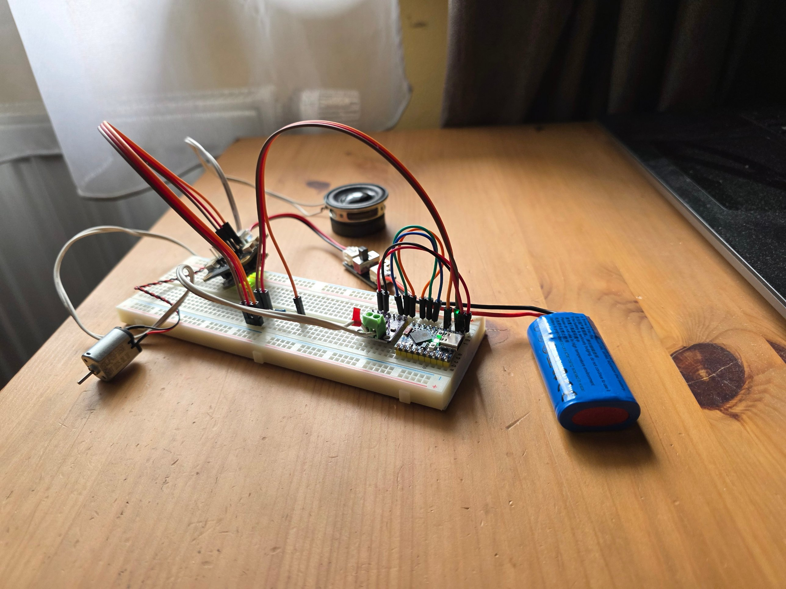
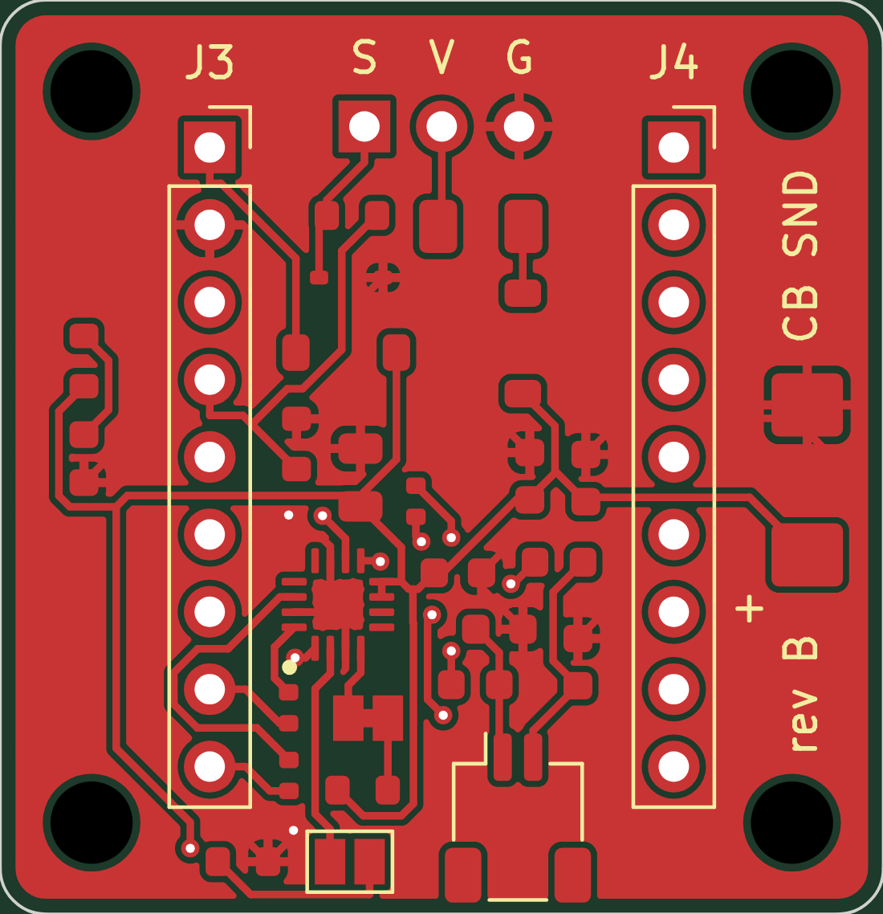
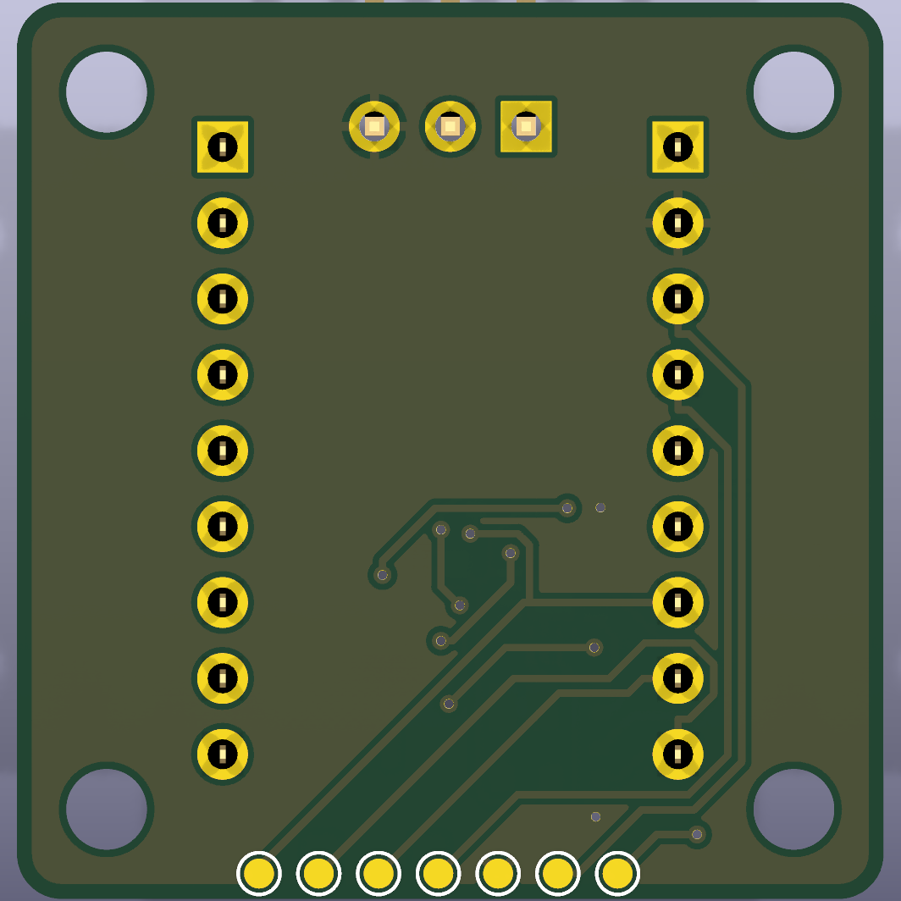

# Project overview: what we built and why

## Goal

The Bambu Lab CyberBrick is an RC kit without sound. This project adds an **engine sound module** for CyberBrick models (first target: a truck): a small board that listens to the throttle, plays a matching engine sound through a speaker, and **never touches the original signal path**. The module is an add-on, not part of the control chain: if it fails, the model still drives.

## How the module gets the throttle

The CyberBrick receiver has four servo headers (S, V, G: signal, 5 V, ground). The module hangs on **one servo cable to the S4 header**, which carries both its power and **all transmitter channels as serial data** (since 2026-11-06):

- A small program of ours on the receiver in the model (CyberBrick Remote Control Receiver Shield - XA003 XA004; "Sound data", `cyberbrick-code/uart_forward.py`, stored in the config as a Code module) reads all ten channels every 20 ms and sends them from S4 (GPIO0) at 115200 baud 8N1: a 23-byte frame `A5 5A`, ten 16-bit values little endian `[L1 L2 L3 R1 R2 R3 K1 K2 K3 K4]`, XOR. Measured: about 27 frames per second, no checksum errors.
- The program is started by the transmitter (CyberBrick Remote Control Transmitter Shield - XA003 XA005): a moved stick centre in the transmitter's part of the config (L2) fires its event right after power-up; a long press of the left shoulder button starts it again. Bambu's firmware is unchanged on both boards, only the configuration was changed. What we added where: `controls.md`.
- The module reads the frames on GPIO1 through a 1 kOhm resistor. The throttle is the left stick (L3) as the deflection from its centre with a dead band (`RC_THROTTLE_*` in `config.h`), so forward and reverse both raise the sound. In `engine_lab` the sign of the deflection gives the direction (`RC_REVERSE_SIGN`: stick away from you = forward, checked on the truck 2026-11-08); while reversing the virtual gearbox stays in gear 1, so it does not shift. The direction holds while the stick is at rest. The other channels give the ignition (L1 switch) and the horn (R1).
- Supply on the V pin: about 4.94 V. The module draws about 57 mA idle and 105 mA at full throttle (`MASTER_VOLUME` 0.6, 40 mm speaker).
- Because the original path to the motor (M1) is untouched, **no pass-through connector is needed**. S4 is dedicated to the sound module.

Older variant, still accepted by the firmware on the same input: the throttle stick mapped a second time to an angular servo on **PWM2** (`Truck_with_Engine_Sound.json`), read as a servo pulse: 50 Hz, about 3.3 V, 977 to 1973 us, rest at about 1455 us (measured on the real receiver). It gives only the throttle, no ignition or horn.

Controls, the receiver program and its auto-start: `controls.md`; measurements: `bringup.md`; configurations: `cyberbrick-config/`.

## Hardware

### Prototype (works, on a breadboard)

*The breadboard prototype that the shield PCB reproduces (photo from the project owner, 2026-11-01).*

| Part | Role |
|---|---|
| Waveshare ESP32-S3-Zero-N8R8-M | controller; reads the receiver's channel data (or the older servo pulse) on GPIO1 through a 1 kOhm resistor; I2S on GPIO4 (DIN), GPIO5 (BCLK), GPIO6 (LRC); onboard RGB LED (GPIO21) for status |
| MAX98357A breadboard module | I2S class-D amplifier; the firmware sends the same sample on both channels because the amplifier outputs (L+R)/2 |
| 40 mm speaker (4 Ohm) | prototype speaker |

Rule on the breadboard: never connect USB and the servo-port 5 V at the same time. Current wiring: `wiring-current.png` (one servo cable to S4, data and power); earlier stages: `wiring-overview.png`, `wiring-stage2.png`, `wiring-test-tone.png`.

### Shield PCB (iteration 2: KiCad schematic and routed board exist, not yet reviewed or manufactured)

A carrier board ("shield") that replaces the loose wires. Scope and component list: `shield-pcb.md`; 2D mock `shield-mock.png`; interactive 3D model `shield-3d.html`; both are generated from `tools/shield_layout.py` by `tools/make_shield_mock.py`.

The real KiCad design is in `hardware/shield/` (schematic `shield.kicad_sch`, board `shield.kicad_pcb`, manufacturing files in `fab/`); details and open review points in `shield-pcb.md`. Top and bottom renders:  

- **Size and holes:** 29 x 30 mm, the size of the CyberBrick receiver shield, with the same four mounting holes (2.7 mm, spacing 23.0 x 24.0 mm, confirmed on 2026-11-07 from the official CAD model of the receiver). The Zero (18 x 23.5 mm) sits in the middle in two 9-pin female header strips; most parts are in the gap under it.
- **Input J1:** 3-pin right-angle male header at the USB end (S, V, G) for the servo cable to the receiver's S4 header (channel data and power).
- **Protection and power:** 1 kOhm series resistor and 100 kOhm pull-down on the signal, resettable fuse, Schottky reverse-polarity diode, an OR-ing diode so USB and servo-port 5 V can be connected together, 100 uF bulk and ceramic decoupling capacitors.
- **Amplifier:** bare MAX98357A chip (TQFN-16), to be **assembled by a PCB service** because it cannot be hand-soldered in practice. No plug-in breakout module.
- **Speaker J2:** JST SH 1.0 mm 2-pin side-entry connector, the same type as the CyberBrick motor and button ports. The CyberBrick kit contains a suitable 10 cm cable (bag B-IC004), and SH 1.0 pigtails are cheap, so users need no crimping.
- **Service items:** a green power LED (from the servo-port 5 V) beside the Zero, bottom test pads, four mounting holes.
- **Rejected on the way:** a Zero-sized board without holes (no room for anything), a variant with fragile "ears" for the holes, a spare GPIO header (recorded as a future option); the full list is in `rejected-ideas.md`.

## Firmware (`firmware/`, PlatformIO, Arduino framework)

Every firmware shares the pins and constants in `include/config.h`. Environments (`pio run -e <env> -t upload`):

| Env | What it does |
|---|---|
| `test_tone` | 440 Hz sine over I2S; checks amplifier and speaker |
| `pulse_measure` | prints the throttle pulse width to serial |
| `engine` | synthesised firing-pulse loop played back at a throttle-dependent rate |
| `engine_pulse` | real-time synthesis: throttle sets how often a combustion grain is triggered (default sound, preset a_diesel6) |
| `engine_diesel` | like `engine`, with a real diesel idle loop (CC0), plus the virtual gearbox |
| `engine_truck` | real truck idle loop (CC0) with the virtual gearbox and a second "under load" loop blended in with the throttle |
| `engine_gears` | test: a separate CC0 truck loop for each of the 5 gears (0.75x..1.3x playback), crossfade at a shift, gear number announced with 1..5 beeps |
| `engine_real` | experiment with owner-supplied recordings (not in the repo, licence unknown) |
| `engine_lab` | the current firmware: all engine-sound candidates (the BOOT button switches 1..6 and beeps the number), ignition, starter, stop and horn from the channel data, speaker EQ for the 30 ml box |

How it works: the module reads the channel frames from the receiver (`include/rc_link.h`) or, with an older configuration, measures the servo pulse width with a pin interrupt; the throttle is the deflection from the centre with a dead band and a timeout (no data or pulse for 150 ms means idle); the RPM is smoothed (rises faster than it falls); the I2S output is written in blocks of 128 samples at 22.05 kHz.

Extras in the `engine*` firmware:

- **Virtual gearbox** (`include/gearbox.h`, tested on a PC with `tools/test_gearbox.cpp`): the module only sees the throttle, so it keeps a virtual speed that follows the stick with inertia, derives one of five gears and shifts: the pitch drops and the sound dips for a quarter of a second on an upshift, and the pitch jumps up on a downshift. It is an effect, not a simulation. Tunable in `config.h`.
- **Status LED** (`include/status_led.h`) on the Zero's onboard RGB LED: blue flash at start, red when no valid pulse arrives, dim green with the stick at rest, brightening to cyan with the throttle. On the real Zero the red and green channels are swapped, which `STATUS_LED_SWAP_RG` corrects.

## Sound: why it is built this way

Research and measurements are in `sound-research.md`. The constraints that decided everything:

- The speaker is small (40 mm prototype, 21 mm production candidates) and reproduces almost nothing below about 300 Hz. Sound that lives below 150 Hz is nearly inaudible and turns into hiss. The first CC0 car loops were almost pure 40 to 80 Hz tones and failed for exactly this reason.
- Playing a loop faster shifts the whole timbre, not just the firing rate, so a single loop turns into a siren at high rates. That is why the synthesised grain engine (`engine_pulse`) keeps the grain timbre fixed and changes only the rate, and why the real-loop firmware limits the rate range and adds a second layer.
- Real recordings used must be **CC0**. Origins, authors and checks are in `assets/samples/LICENSE-SAMPLES.md`: Citroen diesel idle (chlund), truck idle (wesleywestmusic), truck under load (kyles). Only short derived loops are stored, not the originals. The tools that cut and convert them are `tools/make_diesel_loop.py` and `tools/make_engine_diesel.py`.

## What was tested, and how

**On the real hardware (receiver, Zero, amplifier, speaker):**

- `engine_truck` (real truck loop, virtual gearbox, "under load" layer) compiled, uploaded and ran on the owner's hardware (reported 2026-11-01). Sound quality is a subjective judgement that can be revisited at any time, so no verdict is recorded; the sound stays unchanged for now.

- Throttle copy on PWM2: 50.0 Hz, about 3.3 V, 977 to 1973 us, rest 1445 to 1465 us, V pin 4.94 V (`bringup.md`, measurements table). Pin order of the servo port confirmed.
- Breadboard prototype end to end: the engine sound follows the real stick in both directions. Powered from the PWM2 V pin the module drew about 57 mA idle and 105 mA at full throttle (`MASTER_VOLUME` 0.6, 40 mm speaker); the receiver stayed stable and the motor kept responding.
- Channel data on S4 (2026-11-06): about 27 frames per second without checksum errors; ignition, starter, stop and horn work from the transmitter; the program starts by itself after power-up (`controls.md`).
- Sound, judged by listening on the real speaker: the first CC0 car loops were nearly inaudible and hissy; a synthesised pulse loop was audible ("less pretty but better heard") but turned into a siren when sped up; the grain engine `engine_pulse` (a_diesel6) sounded deeper and was chosen as the default; the owner's own recordings pulsated when looped and were parked.
- Status LED on the Zero: it showed that red and green are swapped on this board (no signal showed as green, signal present as red); after `STATUS_LED_SWAP_RG` the colours match: red at start until the first pulse, green with the stick at rest, blue-cyan with throttle.

**Offline only (on a PC, judged by measurement or by the owner listening to rendered files):**

- Spectrum, level and loop seams of all sound candidates; rendered throttle sweeps of the Citroen and the truck loops. For the truck, a playback rate of 1.0x to 3.0x sounded better than 1.0x to 4.0x (at 4x the timbre shifts too far and more of the sound aliases at 22.05 kHz).
- Gearbox logic: simulated with `tools/test_gearbox.cpp` (it shifts as designed).
- Dimensions of the shield: hole spacing 23.0 x 24.0 mm, confirmed from the official CAD model of the receiver (`shield-pcb.md`).

**Not yet checked on hardware:**

- `engine_diesel` (real loop, gearbox). The assistant's build environment cannot download PlatformIO packages, so it passed only a syntax check with stand-in Arduino headers.
- The shield PCB itself: a KiCad schematic and a routed board with manufacturing files exist (`hardware/shield/`, see `shield-pcb.md`), but they have not been reviewed by a human in KiCad and nothing has been manufactured.
- The loaded layer's level and pitch match (`LOADED_GAIN`, `LOADED_RATE_SCALE`) were set from measured values, not by ear.

## Open decisions

Ideas already considered and dropped, with the reasons: `rejected-ideas.md`.

- Which sound wins: synthesised grains, Citroen, or truck with gearbox (to be judged by listening on the real speaker).
- Speaker: 40 mm or a production candidate (for example a 21 mm one). The sealed box is done (30 ml best, 15 ml close; `speaker-measurement.md`); further improvement, if needed, would come from a larger or different speaker or a different amplifier / converter, not from the box. The printed box is a test fixture only; the enclosure for the model will be designed from scratch
  around the chosen speaker.
- Shield: a human review of the board in KiCad; an exact quote. Prepared on 2026-11-08: the service fits all SMD parts (LCSC numbers and JLCPCB files in `hardware/shield/fab/`, steps in `shield-pcb.md` "Ordering at JLCPCB"), J1/J3/J4 are soldered by hand. Decided on 2026-11-08: the Zero sits in sockets, the speaker connector is JST SH like the CyberBrick motor port; a strain-relief slot for a soldered servo cable was considered and rejected (`shield-pcb.md`).
- A long power test with the motor running, to see whether the servo-port 5 V supply holds.
- Development outlook (2026-11-08), not started:
  - a USB-audio test firmware (the Zero as a speaker for the PC): tried on 2026-11-08, does not work with the current
    Arduino core; parked until a move to core 3.x (`rejected-ideas.md`);
  - firmware updates over Wi-Fi (OTA), with Wi-Fi switched on only in an update mode (for example BOOT held at
    power-up). The 8 MB partition table already has two 3.3 MB app slots; the current firmware is about 1.15 MB.
  - The sounds are compiled into the firmware as headers (`firmware/include/*.h`), so an OTA update also brings new
    sounds. A separate filesystem partition for the sounds would allow loading them without a rebuild, including own
    recordings that cannot go into the repo.
- Later, optional: spare inputs (for example a switch for an engine-stop sound), a variant for a classic RC receiver (see `shield-pcb.md`).
- ~~Engine start, stop and horn on one transmitter button through PWM3~~: done differently on 2026-11-06, through the receiver's channel data on a single servo cable (S4); see `start-stop-horn.md`. More servo cables are not planned.
