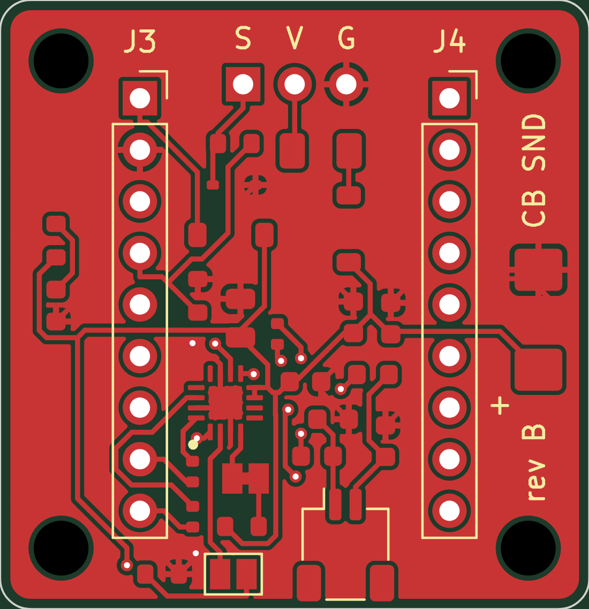
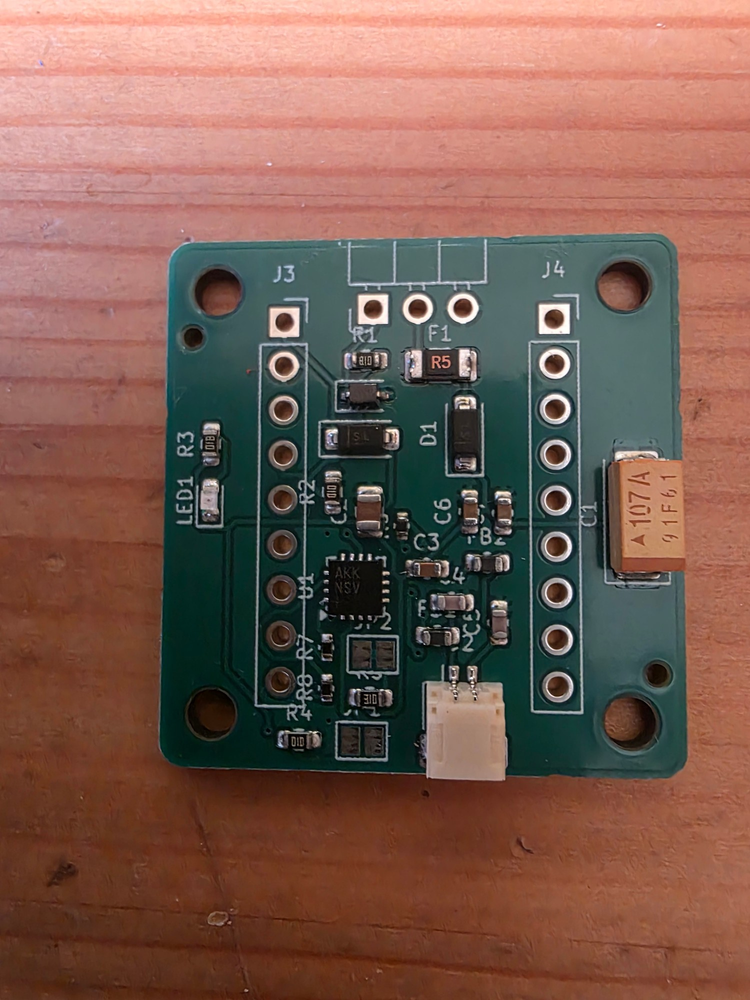

# Shield PCB (iteration 2): scope

Status: KiCad schematic and a first routed board with manufacturing files exist (`hardware/shield/`), reviewed in KiCad by a colleague of the project owner on 2026-11-12 (no remarks), ordered at JLCPCB on 2026-11-13 (5 assembled boards), production file and parts placement confirmed on 2026-11-14, delivered on 2026-11-20 at 12:14 (photo of the five boards: SMD parts fitted, J1/J3/J4 not yet soldered; the owner calls them "rev. 0", in the repository they are rev A). Rev B (silkscreen only, same parts and copper) is prepared in `hardware/shield/` since 2026-11-14 and not ordered; rev A is the tag `hw-shield-revA`. The prototype (iteration 1) is a breadboard with an ESP32-S3-Zero-N8R8-M and a MAX98357A, powered and verified as described in `bringup.md`.

## Input: one servo cable to the receiver's S4 header

The module hangs on a single servo cable to the receiver's **PWM4** header (S4). With the current configuration (`docs/cyberbrick-config/Truck_with_Engine_Sound_Data.json`) our snippet on the receiver sends all transmitter channels there as serial data (what we added where: `controls.md`):

- S: serial data, 115200 baud 8N1, 3.3 V, read on GPIO1 through 1 kOhm
- V: about 4.94 V without load; the module draws about 57 mA idle and 105 mA at full throttle (`MASTER_VOLUME` 0.6, 40 mm speaker)
- G: ground

**The cable:** a flat 3-wire servo cable with a **JR connector** (female, 2.54 mm, 3 pins) on both ends plugs onto J1 on
the board and onto the S4 header on the receiver (both are male pins). JR wire colours: orange = S, red = V, brown = G. It is not soldered to the board (decided 2026-11-12) and is
not part of the PCB order; it is bought or made separately, like the speaker (component list: "Servo cable"). Keep
the wire order the same on both ends: S, V, G.

S4 is dedicated to the sound module. The original path to the motor (port M1) is untouched, so **the board needs no pass-through connector**. A second servo input for start, stop or horn is not planned (decided 2026-11-07).

Older variant, still accepted by the firmware on the same input: the throttle copied to **PWM2** in the app (`Truck_with_Engine_Sound.json`), 50 Hz, about 3.3 V, 977..1973 us (45..135 deg), centre about 1455 us. Then J1 goes to PWM2 and nothing else may be connected there (a servo would follow the throttle).

## Schematic

The first real design step: the KiCad 7 schematic `hardware/shield/shield.kicad_sch` (PDF: `shield-schematic.pdf`), generated by `tools/make_shield_schematic.py` from the pin-level netlist in `tools/shield_netlist.py`. `tools/check_shield_netlist.py` makes KiCad export the netlist and compares it with the intended one (23 nets, 0 differences). The MAX98357A pinout and the GAIN / SD_MODE values were checked in the datasheet: GAIN through 100 kOhm to ground = 15 dB, floating = 9 dB; R_LARGE = 222.2 x VDD - 100 kOhm, so 1 MOhm gives the (L+R)/2 mix at about 4.6-5 V. Open point found in the datasheet: **22.05 kHz is not a supported sample rate** of the MAX98357A (8, 16, 32, 44.1, 48, 88.2 and 96 kHz are), although the prototype plays at 22.05 kHz.

## Board (KiCad 7, first routed version)

`hardware/shield/shield.kicad_pcb` is generated by `tools/make_shield_pcb.py` (real footprints, nets from `tools/shield_netlist.py`, positions from the annealer `tools/place_shield.py` -> `tools/shield_placement.json`, routing by Freerouting, ground pour on both layers). Images: `shield-pcb-top.png`, `shield-pcb-bottom.png`.

- 2 layers, 29 x 30 mm, tracks 0.25 mm, clearance 0.2 mm, vias 0.6/0.3 mm, copper-to-edge 0.3 mm. J1 (right-angle header) sticks out of the top edge, the J2 speaker connector opens toward the bottom edge, test pads are on the bottom side.
- DRC (run through pcbnew, KiCad 7 has no command-line DRC): 0 unconnected, 0 clearance / short / courtyard / edge errors. Remaining messages are warnings only: silkscreen overlaps and silkscreen clipped at the edge (J1 outline hangs outside the board), and a library-path warning from the generated footprints.
- Manufacturing outputs in `hardware/shield/fab/`: `shield_gerbers.zip` (Gerber + drill), `shield_positions.csv`, `shield_bom.csv` (values, footprints from the board, LCSC part numbers) and the assembly files for JLCPCB in `fab/jlcpcb/` and for PCBWay in `fab/pcbway/` (made by `tools/make_shield_outputs.py`; `--bom-only` rebuilds only the BOMs and assembly files). How to order: "Ordering at JLCPCB" and "Ordering at PCBWay" below.
- **Interactive BOM** `hardware/shield/fab/shield_ibom.html`: open it in a browser; a part clicked in the list lights up on the picture of the board and the other way round. It is where the reference labels went (R1, C3, ...), because rev B has none on the silkscreen; use it for repairs and measuring. Made by `tools/make_shield_ibom.py` (InteractiveHtmlBom 2.12.0, installation in the file's header); regenerate it after any board change.
- **Reviewed in KiCad on 2026-11-12** by a colleague of the project owner, with no remarks. Still to do before ordering: a stock check of the parts and the open decisions below (socket height vs the parts under the Zero). The routing is autorouter quality, not hand-optimised; it has not been through any signal-integrity or EMC check.

## On the board

Mock of the layout (top view, illustrative placement, not routed). An interactive 3D model is `shield-3d.html`. Both are generated from the same layout data by `tools/make_shield_mock.py` (layout in `tools/shield_layout.py`). The mock shows **every component of the component list below** (including the optional ones: ESD diode, 33 Ohm I2S series resistors, speaker ferrite beads and capacitors, GAIN / SD_MODE resistors with solder jumpers, extra 100 nF capacitors). Positions and connections of the small parts are indicative only: nothing is routed or checked against design rules, the pad assignment of the amplifier is simplified, and the bulk capacitor C1 sits in the right margin of the board because it does not fit in the gap.

**Board: 29 x 30 mm, the size of the CyberBrick receiver shield, with its four mounting holes** (see below). The ESP32-S3-Zero (18 x 23.5 mm) sits in the middle in two 9-pin female header strips (15.24 mm apart, 8.5 mm tall). Most parts are in the 12.7 mm gap under the Zero (everything under it stays below about 4.4 mm); the power LED is beside the Zero, where it stays visible. Only the two cable plugs stick out: the servo plug at the USB end (right-angle header J1) and the speaker plug at the opposite end (side-entry JST SH 1.0 mm J2). With the Zero the stack is about 14 mm high. All pins used by the firmware are on the left column of the Zero (5V, GPIO1, GPIO4-6); the right column is unused and stays free at the socket.

1. **Socket or pads for the ESP32-S3-Zero**, same pin use as the prototype: GPIO1 throttle in, GPIO4 I2S DOUT, GPIO5 BCLK, GPIO6 LRC. The USB-C port and the Boot/Reset buttons must stay reachable for flashing.
2. **Input connector** (3-pin servo type: S, V, G) to PWM4 (S4; PWM2 with the older pulse configuration). S goes through a 1 kOhm series resistor to GPIO1, optionally with a large pull-down (for example 100 kOhm) so the input is defined when disconnected, and optionally an ESD/TVS device.
3. **Power from the servo port**: reverse-polarity protection (Schottky diode or P-MOSFET), a resettable fuse, a bulk capacitor (about 100-470 uF) near the amplifier and small ceramic decoupling capacitors. A diode (or ideal diode) between the servo-port 5 V and the USB 5 V so both can be connected at the same time; the breadboard has the same arrangement with a 1N5819 since 2026-11-12
(measured in `bringup.md`).
4. **MAX98357A amplifier**: gain and shutdown/channel pins configurable (resistors or jumpers), speaker output to a JST SH 1.0 mm 2-pin connector (see below) or solder pads. The chip is hard to solder by hand; assembly by a PCB service is likely.
5. **Service items**: test points (5 V, 3.3 V, GND, GPIO1, I2S lines) as pads on the bottom side, four M2/M2.5 mounting holes in the CyberBrick pattern, a **power LED** (taken from the servo-port 5 V after the reverse-polarity diode, so it shows that cable and receiver are fine; the Zero has no power LED of its own, only a programmable RGB LED). The status of the signal is shown by the Zero's own RGB LED from firmware (see the README).

## Mounting holes matching the CyberBrick receiver shield

The receiver shield (XA004) is 29 x 30 mm with four corner holes: 2.7 mm in diameter with a copper ring of about 5.7 mm (from the manufacturer's product image, reference only, not stored here), centred 3.0 mm from the board edges. The spacing is **23.0 x 24.0 mm** according to the CAD model of the community "CyberBrick Remote Control Receiver Test Housing" (its four heat-set insert holes of 3.1 mm are at +-11.5 / +-12.0 mm from the centre; the pocket for the board is 30 x 31 mm); the product image gives the same within its reading error. The test housing is only a size reference: our board needs the servo input and the speaker output and does not go into that housing. Our board is therefore a plain rectangle of the same size as the receiver shield (29 x 30 mm) with the same four holes, and the Zero (18 x 23.5 mm) sits in the middle, as drawn above.

**Confirmed 2026-11-07 from the official CAD model** of the receiver ("Remote Control Receiver-XA003-XA004", STEP from
Bambu Lab, assembly `PCBA-V2000_ASM`, board `PCB-V2000`; not stored here): board 29.0 x 30.0 mm, four holes of 2.7 mm at
+-11.5 / +-12.0 mm from the centre, so **23.0 x 24.0 mm** apart and 3.0 mm from the edges, with a 6.0 mm copper ring. Our
board (`hardware/shield/shield.kicad_pcb`) has the same outline and holes. No caliper measurement needed for the holes.

To check before ordering: find out which way the receiver sits in its housing (the J1 and J2 plugs must stay accessible). A screw head of 4.5 mm leaves only about 0.25 mm to the corner of the Zero, so use a low or countersunk head or shift the Zero. The screw size is not known (the housing's 3.1 mm holes are for heat-set inserts, probably M2, and the 2.7 mm board holes would also take M2.5).

## Connectors used by CyberBrick

From the Maker's Supply CyberBrick user's manual (the Bambu store page names only the power input): DC motor ports M1/M2 and the transmitter button ports K1-K4 are **JST SH 1.0 mm 2-pin**; joystick (ADC) and WS2812 LED ports are SH 1.0 mm 3-pin; servo ports S1-S4 are 3-pin headers (2.54 mm); power inputs and the power switch are **XH 2.54 mm 2-pin**. The kit's SH 2-pin wires (button module, N20 motor) therefore fit a speaker connector of the same type, so the speaker connector J2 is SH 1.0 mm 2-pin and users need no crimping: a 2-pin SH cable with one free end is soldered to the speaker (or supplied with it). The CyberBrick kit contains a suitable cable: bag **B-IC004**, "100 mm Wire Pair with SH1.0", SH1.0 2-pin, 10 cm, with a plug on both ends (photo from the project owner). Cut off one plug and solder the wires to the speaker, so the speaker sits within about 10 cm of the board. **Chosen cable for the boards (2026-11-12): Bambu Lab "200mm
Wire Pair with SH1.0 (5PCS) - IC007"** (Bambu Lab store, Maker's Supply): SH1.0-2P, 200 mm, 30 AWG, plugs on both
ends, 5 pieces per pack, so one pack serves the 5 boards. Cut off one plug and shorten to fit; 20 cm of 30 AWG adds
about 0.14 Ohm, negligible against the 4 Ohm speaker. Also sold: 50 mm (IC005), 100 mm (IC004) and 300 mm (XC014,
2 pieces). The speaker is not polarised in any way that matters here, so the wire order does not need to be tracked.

## Ordering at JLCPCB

**Ordered on 2026-11-13** (see "Order of 2026-11-13" below). Prepared on 2026-11-08, reviewed in KiCad on
2026-11-12.

### Order of 2026-11-13

- JLCPCB order [order number removed], paid 2026-11-13: PCB [number removed] and Economic PCBA [number removed],
  5 boards, files from `fab/jlcpcb_basic/`. **LED1 is therefore red** (Kento KT-0603R, C2286), not green: the
  board files and `shield_bom.csv` still say "green" (the design value, rev A tag), the files that were ordered say
  red. Its drop is lower than a green one's, so with the 1 k resistor it takes a little more than the 3 mA estimated
  below; to be seen at the first power-up. All differences between the ideal and the ordered parts: `shield-bom-compare.md`.
- Options: 2 layers, 1.6 mm, green, HASL with lead (free, easiest for hand-soldering J1/J3/J4), Confirm Production
  file and Confirm Parts Placement (JLCPCB sends both for approval before production), tooling holes added by
  JLCPCB, nitrogen reflow, PCB build time 24 hours. Customs description: "DIY Hobby Circuit Board - HS Code 902300"
  (the cart shows it as "jlcpcb_missing_text", a display fault at JLCPCB).
- Placement preview checked before ordering: LED1 (cathode), C1 (plus), D1 and D2 (cathode), U1 (pin 1) and J2
  (opening to the board edge) all match the silkscreen; all 15 parts matched and in stock.
- Paid: goods 45.46 USD, shipping 24.31 USD (DHL Express), customs duties and taxes paid in advance 14.64 USD, total
  **84.41 USD**. EuroPacket was the plan; DHL Express was what got selected at checkout (about 15 USD more, faster,
  nothing to pay at the door).
- **Production file and parts placement confirmed on 2026-11-14** (JLCPCB asked for both that morning). Checked
  before confirming: the production file (top and bottom) matches the board, with the two tooling holes JLCPCB adds;
  the placement has all 24 parts of the `jlcpcb_basic` BOM, nothing revised by their engineer, and every polarised
  part matches pin 1 of the board: U1 (pin 1 bottom left), C1 (plus at the bottom), D1 (cathode at the bottom), D2
  (cathode on the left), LED1 (anode at the top, cathode at the bottom), J2 (pin 1 on the left, opening to the
  edge).
- Known and accepted for this order: some reference labels and outlines on the silkscreen run over pads (C2, R5,
  JP1/JP2, FB1 and others; KiCad's DRC warned about it on 2026-11-01: 13 silkscreen over copper, 17 overlapping,
  18 too close to the edge). Only cosmetic: JLCPCB clips the silkscreen from exposed pads, so some labels come out
  cut. Not worth replacing the files of a paid order; fixed in rev B (see "Revisions").
- Delivered on 2026-11-20 at 12:14 (five boards). Next: solder J1, J3 and J4 and do the first power-up checks (`roadmap.md`).

Parts (LCSC numbers, all in stock on 2026-11-08; the list is in `tools/make_shield_outputs.py`):

| Ref | Part | LCSC |
|---|---|---|
| U1 | MAX98357AETE+T, I2S class-D amplifier, TQFN-16 3x3 | C910544 |
| J2 | JST SM02B-SRSS-TB, SH 1.0 mm 2-pin right angle | C160402 |
| C1 | tantalum 100 uF 10 V, case C 6032 (Kyocera AVX TAJC107K010RNJ; the 6.3 V TAJB107K006RNJ, C16133, was rejected: no headroom at 5 V, and it is case B) | C8649 |
| C2 | 10 uF 25 V X5R 0805 | C15850 |
| C3, C6, C7 | 100 nF 50 V X7R 0603 (Samsung CL10B104KB8NNNC; first choice YAGEO CC0603KRX7R9BB104, C14663, out of stock on 2026-11-08) | C1591 |
| C4, C5 | 100 pF 50 V C0G 0603 | C14858 |
| D1, D2 | B5819W, Schottky 40 V 1 A, SOD-123 | C8598 |
| F1 | PTC 500 mA hold, 13.2 V, 1206 (Ruilon SMD1206P050TF/13.2) | C43379 |
| FB1, FB2 | ferrite 600 R @ 100 MHz, 1.3 A, 0603 (Murata BLM18KG601SN1D) | C85833 |
| LED1 | green LED 0603 in this full BOM (rev A was ordered with the red one from the basic-parts variant, see "Order of 2026-11-13"; Kento KT-0603G; first choice Everlight 19-217/GHC-YR1S2/3T, C72043, out of stock on 2026-11-08) | C12624 |
| R1, R3 | 1 k 0603 | C21190 |
| R2, R4 | 100 k 0603 | C25803 |
| R5 | 1 M 0603 | C22935 |
| R6, R7, R8 | 33 R 0402 | C25105 |
| TVS1 | PESD5V0S1BA, ESD diode 5 V, SOD-323 | C19224 |
| J1, J3, J4 | right-angle 1x3 pin header 2.54 mm; two 1x9 female socket strips 2.54 mm | by hand |

Several of them are "extended" parts at JLCPCB (U1, J2, C1, F1, FB1/FB2, TVS1, ...), each with a small loading fee.

Chosen on 2026-11-12: the basic-parts variant (`fab/jlcpcb_basic/`, see step 2).

Steps:

1. PCB: upload `hardware/shield/fab/shield_gerbers.zip`. 2 layers, 1.6 mm, the size is read from the outline
   (29 x 30 mm). Colour: green, the default (decided 2026-11-13). Black was possible at no extra cost (one day
   longer build time; Economic PCBA takes green or black for 2-layer 1.6 mm) but is not needed.
2. Assembly: top side only. Upload `fab/jlcpcb/shield_bom_jlcpcb.csv` (BOM) and `fab/jlcpcb/shield_cpl_jlcpcb.csv`
   (positions). J1, J3, J4, the solder jumpers JP1/JP2, the test points and the holes are not in these files.
   A cheaper variant is in `fab/jlcpcb_basic/` (same positions): JLCPCB "basic" parts where one exists, so 5
   instead of 8 extended part types (about 9 USD less in loading fees, checked 2026-11-12): C3/C6/C7 YAGEO
   CC0603KRX7R9BB104 (C14663), FB1/FB2 Murata BLM18PG121SN1D (C14709, 120 R, 2 A) and LED1 **red** Kento KT-0603R
   (C2286; no green 0603 is a basic part). C1, F1, J2, TVS1 and U1 have no basic equivalent. Upload one variant or
   the other, not both. Price comparison of all options: `shield-cost-comparison.md`.
3. **Check every part in the placement preview.** The rotations are KiCad's and JLCPCB's footprints can be turned
   differently; fix the rotation in the preview where a part is off. Found in the preview on 2026-11-12 and already
   corrected in the CPL (`JLC_ROTATION_FIX` in `tools/make_shield_outputs.py`): C1 was turned 180 degrees (plus side
   at the wrong end) and U1 by 90 degrees (pin 1 one corner off); D1, D2, LED1 and J2 were right. Choose "Confirm
   Parts Placement" so JLCPCB sends its placement for approval before production. A quote that day for 5 assembled
   boards (Economic, top side): 54.31 USD incl. parts (13.48 USD) and the extended-parts fee (24.72 USD), without
   shipping. Watch the polarised parts: U1 (pin 1 dot),
   D1 and D2 (cathode bar), C1 (plus side), LED1 (cathode), and J2 (the plug opening towards the board edge).
4. After delivery: solder J3/J4 (the Zero's sockets) and J1 by hand.
5. First power-up: the checks listed under "Decided" (USB and receiver connected together).

## Revisions

The board is versioned with letters (rev A, rev B, ...), apart from the firmware's numbers (0.1.0). Every revision
that is actually ordered gets the git tag `hw-shield-rev<letter>` on the commit with the files that went to the
factory; files changed after that belong to the next revision. Decided 2026-11-14.

| Rev | Ordered | Tag (commit) | What changed | Tried with firmware |
|---|---|---|---|---|
| A | 2026-11-13, JLCPCB, 5 assembled | `hw-shield-revA` (`b5c9992`) | first board | delivered 2026-11-20 12:14, soldering J1/J3/J4 and the first power-up next |
| B | not ordered | (tag when ordered) | silkscreen only: revision and name on the board, labels for the person holding it | - |

Rev A as delivered on 2026-11-20 (photo of 2026-11-21): the SMD parts are fitted, J1, J3 and J4 are soldered by hand.

**First power-up of rev A (2026-11-21, first board, Zero fitted on the 8.5 mm sockets):**

- J1, J3 and J4 soldered by hand; no short between 5V and GND; with USB only the 3V3 is 3.3 V (TP2 against TP3).
- With USB alone the amplifier is silent and LED1 is dark: by design the amplifier and the LED are on the +5V rail, which only the servo port feeds (D2 lets the rail feed the Zero, not the other way). Sound needs the receiver.
- Firmware `engine_sets` (`pio run -e engine_sets -t upload`, then `-t uploadfs` for the seven sets) and the web app work over USB; the module answers with firmware 0.1.0+7890eb9.
- **The servo cable was turned at first**: with S and G swapped the voltage at J1 fell to 2.6 V with the Zero fitted and 3.1 V without it (the receiver port gives 4.7 V unloaded), LED1 still lit, nothing got warm, the Zero stayed dark. Turned right, J1 showed 4.8 V. So a turned cable is more than "mild": the module does not start, but nothing is damaged. The labels and the colour mark on the S wire are worth it (see "A servo cable turned 180 degrees" below). With the GME cable 775-123 used here, the yellow wire is S (seen from the bottom of the board it is on the right).
- Result: **there is sound** (the module speaks and plays the demo through the speaker).
- **Start and horn did not work at first because the cable sat in the wrong receiver port**: the shield was powered (the V pin is the same on every port) and the throttle seemed to arrive (the RGB LED stayed green, the log showed `PULSE`, `frames 0, 0 bad`), but no channel data reached the module. After the cable was moved to **S4** the ignition switch, the starter and the horn worked (2026-11-21). Symptom to remember: sound demo and power fine, start and horn dead, `frames 0` in the USB log, the physical motor still drives.

Rev A carries no revision on the board itself (no text on the silkscreen) and its gerbers say `rev?`; only the
schematic's title block says rev A. Tell it from rev B by the text "CB SND rev B" in the right margin. Everything
of rev A (the board, the manufacturing files that were ordered) is in git under the tag: `git show
hw-shield-revA:hardware/shield/fab/shield_gerbers.zip`.

### Rev B (prepared 2026-11-14, not ordered)

Made by `tools/make_shield_rev_b.py` from the rev A board; nothing electrical changes (no part, pad, track or zone
moves). Checked: the BOM, the placement files (`fab/jlcpcb*`, `fab/pcbway`, `shield_positions.csv`) come out the same
as for rev A, the copper, mask, paste and drill gerbers are the same as rev A's plotted by the same KiCad, KiCad's DRC
finds 0 violations (rev A: 53 silkscreen warnings) and 0 unconnected items. The silkscreen:

- **Only what helps the person holding the board**: S V G above the servo header J1 (the cable can be put on the
  wrong way round, which puts the supply on the signal pin), J3 and J4 at the Zero's sockets (square pad = pin 1, for
  the Zero's orientation), a plus at C1 (tantalum), a dot at pin 1 of U1 (visible only without the Zero), "CB SND" and
  "rev B" in the right margin, and the outlines of J2, J3, J4 and JP1.
- **Gone**: the reference labels (R1, C3, ...), the outlines of the small parts (they moved to the fab layer, so the
  assembly drawing keeps them) and the outline of J1, which hung over the board edge. The references stay in the
  schematic, the BOM and the placement files; JLCPCB places the parts from those, not from the silkscreen.
- **Size**: every text is 1.0 mm high with a 0.15 mm stroke (JLCPCB's advice, 1 mm and 0.15 mm; to be checked in their
  rules before the order). The labels of rev A were 0.8 mm / 0.12 mm.
- **Files**: the title block says rev B (board and schematic) and the gerbers carry `Revision: B`. The board is saved
  by KiCad 10 (rev A: KiCad 7), so it opens in KiCad 10 or newer. `tools/make_shield_pcb.py` still generates the
  rev A board; to rebuild rev B run it, then `tools/make_shield_rev_b.py`, then `tools/make_shield_outputs.py`
  (with KiCad's `kicad-cli` on the PATH). The interactive BOM comes from `tools/make_shield_ibom.py`.
- **Parts, decided 2026-11-14: if rev B is ordered, try to fit the ideal parts**, that is the files of the full BOM
  in `fab/jlcpcb/` (green LED C12624, Samsung 100 nF C1591, ferrites 600 R C85833), not the basic-parts variant of
  rev A; the differences are in `shield-bom-compare.md`. Costs about 9 USD more in loading fees; check the stock of
  those parts at LCSC again before ordering (the first choices were out of stock on 2026-11-08), and the placement
  preview as for rev A. It is a try, not a must: if the rev A parts prove fine at the first power-up (red LED, 120 R ferrites), or the extra
  cost is not worth it, the basic-parts variant stays. If one ideal part is not available, fall back to its basic
  equivalent and record it.
- **Done 2026-11-20, from a note on the first boards: the S V G labels of rev B were covered by the connector.** `make_shield_rev_b.py` puts them at y 101.9 mm, which is under the black plastic body of the right-angle header J1 (it lies on the board from y 100.05 to 102.71), so once J1 is soldered, and with the cable plugged in, the letters cannot be seen. Fixed in `make_shield_rev_b.py` (`LETTER_Y`), in the board and in the gerbers of `fab/` (regenerated, DRC 0 violations, 0 unconnected; only the silkscreen layer changed): the letters are now in the free strip between the pad row of J1 (y 104.15, pads end at about 105.0) and R1/F1 (from y 106.6), for example y 105.8 mm with 1.0 mm text, still above the three pins' x positions (111.96, 114.50, 117.04); check the DRC and that the text does not touch the pads or R1/F1. Rev A has no S V G letters at all (only the outline of J1).
- Before ordering: look at the gerber preview once (JLCPCB's or KiCad's viewer) and check the text sizes against
  JLCPCB's current silkscreen rules; then the tag `hw-shield-revB`.

## Next revision

Collected for the version after rev B (the silkscreen of rev B is done, see "Revisions"):

- Whatever the first assembled boards (rev A) show at power-up.
- **Optional, only if two revisions need different firmware**: a board ID the firmware can read, for example a
  resistor divider on one of the spare pins IO10..IO12 read by the ADC. Not needed while the pins stay the same.

## Ordering at PCBWay

Prepared on 2026-11-08 as the second option, so both services can be quoted for the same board; not ordered yet.

How it differs from JLCPCB:

- **Turnkey:** PCBWay buys the parts itself from any distributor, by manufacturer and part number, so it does not
  depend on one stock. The BOM gives the LCSC number as an alternative source.
- **It fits every part, the through-hole ones too:** J1 (right-angle servo header) and the Zero's socket strips J3/J4.
  The board arrives complete, nothing is soldered by hand.
- **The files are checked by a person** before production (including the part rotations); the price is confirmed
  after that review, usually within a day or two, not instantly.
- For a small series the assembly is usually more expensive than at JLCPCB. Online quote on 2026-11-12 for 5
  boards (turnkey, top side, 24 SMD + 3 THT): PCB 5 USD + assembly 88 USD, DHL to the Czech Republic 33.16 USD minus
  a 30 USD shipping discount, 96.16 USD in total **without the parts** (priced after PCBWay reviews the BOM). JLCPCB
  the same day: about 54 USD including the parts but without J1/J3/J4 and without shipping (see above).

Files:

- PCB: `hardware/shield/fab/shield_gerbers.zip` (the same as for JLCPCB; it holds the silkscreen layers PCBWay asks
  for).
- BOM: `fab/pcbway/shield_bom_pcbway.csv`: every fitted part with manufacturer, part number, description, package,
  SMD or THT, and the LCSC number. If PCBWay wants its own template, copy the columns over.
- Positions: `fab/pcbway/shield_centroid_pcbway.csv` (designator, X, Y in mm, layer, rotation), all parts including
  J1, J3, J4.

Parts that only PCBWay fits (checked on digikey.com on 2026-11-08):

| Ref | Part |
|---|---|
| J1 | Sullins PRPC003SBAN-M71RC, pin header 1x3 2.54 mm, right angle |
| J3, J4 | Sullins PPTC091LFBN-RC, female socket strip 1x9 2.54 mm, straight, 8.5 mm high |

Steps: upload the Gerbers, choose assembly ("Turnkey", top side, SMD and through hole), upload the BOM and the
centroid file, and in the comments ask them to check the polarised parts as for JLCPCB (U1 pin 1, D1/D2 cathode, C1
plus side, LED1 cathode, J2 opening towards the board edge) and the orientation of J1 (pins out over the top edge).
Before ordering, check that the 8.5 mm socket height suits the parts under the Zero (`roadmap.md`).

## Needed besides the board (not in the PCB order)

To connect the finished board in the model, whichever service makes it:

- **Waveshare ESP32-S3-Zero-N8R8-M**, plugged into the sockets J3/J4.
- **Servo cable** to the receiver's S4 header: flat servo cable with a female JR connector on both ends (see "Input").
- **Speaker** with an SH 1.0 mm 2-pin cable to J2: Bambu Lab IC007, 200 mm, one plug cut off (see "Connectors used
  **Tip (2026-11-22): do not snip the plug off at the end, cut the cable in the middle instead.** The IC007 has a plug on both ends, so cut in the middle you get **two usable speaker cables** (about 100 mm each, one SH plug and the free wires to solder to the speaker) from one cable, ten from the pack of five. 100 mm may be short for a speaker far from the shield in the model: then cut off the plug at one end, as before.
  The same wire pair with an SH1.0 plug on both ends is sold in four lengths in the Bambu Lab store (screenshot of 2026-11-22): **IC005 50 mm** (5 pcs), **IC004 100 mm** (5 pcs), **IC007 200 mm** (5 pcs, the one ordered) and **XC014 300 mm** (2 pcs). **Cutting in the middle suits the 200 mm cable (two pieces of 100 mm) and the 300 mm cable (two pieces of 150 mm)**; the 50 mm and 100 mm ones would give pieces of 25 and 50 mm, too short for a speaker, so those are not for cutting. For a speaker farther from J2 than 100 mm take the 300 mm cable.
  by CyberBrick").

**Shopping list for the 5 boards of the 2026-11-13 order** (JLCPCB fits only the SMD parts):

| What | Qty | Note |
|---|---|---|
| J1: right-angle male pin header 1x3, 2.54 mm | 5 | Sullins PRPC003SBAN-M71RC, or cut from a 1x40 right-angle strip; soldered by hand |
| J3, J4: female socket strip 1x9, 2.54 mm, 8.5 mm tall | 10 | Sullins PPTC091LFBN-RC; soldered by hand (plug them onto the Zero first so they stay straight) |
| Servo cable, flat, JR female to female | 5 | J1 to the receiver's S4; length to suit the model |
| Speaker cable Bambu Lab IC007 (SH1.0-2P, 200 mm) | 1 pack of 5 | one plug cut off, or better **cut in the middle: two pieces** (see the note below). **All lengths exist** in the same store: IC005 50 mm, IC004 100 mm, IC007 200 mm (5 pcs each) and XC014 300 mm (2 pcs); the 200 and 300 mm ones suit cutting in the middle |
| Speaker, 4 Ohm | up to 5 | the type is still open (`roadmap.md`) |
| Waveshare ESP32-S3-Zero-N8R8-M | up to 5 | one is in the prototype; the "-M" variant has its pin headers fitted, so it plugs into J3/J4 |

**Soldering J1/J3/J4:** a printed stand holds the board upside down, with the Zero (which keeps the two socket
strips straight) in a pocket on a piece of foam and the J1 body on a ledge: `hardware/solder_stand/` (OpenSCAD, the
steps are in the header of `solder_stand.scad`).

The solder jumpers JP1/JP2 need no work for the default setting (9 dB gain, JP2 bridged in copper).

**Ordered at GM Electronic (gme.cz) on 2026-11-13, order [number removed]**, 187.50 CZK incl. VAT plus shipping: **The whole order has arrived (reported by the owner on 2026-11-20): the male header 832-539, the three socket strips 832-093 and the five servo cables 775-123.**

| GME code | Part | Qty | For |
|---|---|---|---|
| 832-539 | KLS S1G20C W90/2, male pin header 1x20, 90 deg, 2.54 mm, breakable | 1 | J1 (six 1x3 pieces) |
| 832-093 | CONNFLY BL140G-V8.5, female socket strip 1x40, 2.54 mm, 8.5 mm tall | 3 | J3, J4 (four 1x9 pieces per strip, 12 in total) |
| 775-123 | Jumper cable, 3 pins, 20 cm, female to female (one 3-pin housing on each end) | 5 | servo cable J1 to S4 |

GME has no breakable 8.5 mm female strip (the breakable "precision" strips are 7 mm with round contacts, too tight
for the Zero's square pins), so the 1x9 pieces are cut: pull out the 10th contact, cut through the empty place,
file the end. The jumper cable's wire colours are not the JR ones; check pin 1 to pin 1 with a multimeter before
the first use. The speaker cables (Bambu Lab IC007, 200 mm, one pack of 5 pieces, one per board) were ordered at the Bambu Lab EU store on 2026-11-13,
order [order number removed]; shipped on 2026-11-14 by DHL ([tracking number removed]); **delivered, five pieces (reported by the owner on 2026-11-20)**. The first board gets the Zero and the speaker of the breadboard prototype (plan of
2026-11-13); more Zeros and speakers are ordered after that board works.

**Ordered at Allegro.cz on 2026-11-13** (one parcel per seller, paid):

| Seller | Part | Qty | Price incl. shipping | Delivery expected |
|---|---|---|---|---|
| piters_pro | Waveshare ESP32-S3-Zero-N8R8-M (SKU 33549, 8 MB flash, 8 MB PSRAM, pin headers fitted) | 1 | 298 CZK (233 + shipping) | by 2026-11-20; **received** (reported by the owner on 2026-11-20) |
| OMEGA_ZONE | Speaker ACS SPK3W40MM, 40 mm, 4 Ohm, 3 W, 20 mm deep (same size as the prototype's Solectro M0069) | 1 | 126 CZK (61 + shipping) | by 2026-11-19 |
**Speakers on hand (reported by the owner on 2026-11-20): three**, the one of the prototype (Solectro M0069 according to the table above) and two new ones of the same kind from another seller (not the OMEGA_ZONE one; whether that order of 2026-11-13 has arrived is not stated).

The Zero is for a second board (received, so there are now two Zeros: the prototype's and this one). On Allegro, many "ESP32-S3-Zero" listings are the ESP32-S3FH4R2 variant (4 MB flash,
2 MB PSRAM), which does not fit the firmware's 8 MB partition table; only N8R8 boards are usable. Still to buy:
Zeros and speakers for the remaining boards, once the speaker type is chosen (`roadmap.md`).

## Decided

- **Manufacturer: JLCPCB with the basic parts (decided 2026-11-12)**, files in `fab/jlcpcb_basic/`, so a red power
  LED. J1, J3 and J4 are soldered by hand. The cheapest option, about half the price of PCBWay
  (`shield-cost-comparison.md`). All 15 parts were in stock that day (the fewest: F1, 13 083 pieces). Ordered on
  2026-11-13 ("Order of 2026-11-13").
- Board size and shape: CyberBrick-sized rectangle (29 x 30 mm) with the four CyberBrick mounting holes (23.0 x 24.0 mm), Zero in the middle.
- **Flashing with the servo cable plugged in must be safe** (requirement from the project owner, 2026-11-08): the module hangs on one cable and the V wire cannot be unplugged on its own. The OR-ing diode D2 stops the USB 5 V from flowing into the receiver, and the servo 5 V reaches the Zero's 5V pad (= USB VBUS) only through D2, about 0.3 V lower than USB, so normally nothing flows back into the computer either. The breadboard rule (never USB and V together) applies only to the prototype without D2. To check on the first boards: voltages and currents with USB and the receiver connected at the same time.
- Power LED on the board (from the servo-port 5 V); the signal status is shown by the Zero's RGB LED in firmware.
- No spare GPIO header in this iteration, to keep the scope small (see "Out of scope").
- **The ESP32-S3-Zero sits in two 9-pin female socket strips (J3, J4), decided 2026-11-08.** It stays replaceable and can go back to the breadboard. Soldering it in only makes sense together with a single board that carries the ESP32-S3 itself (iteration 3, see "Out of scope").
- Servo input J1 stays a 3-pin right-angle pin header (male) for now; it mates with a female-to-female servo/Dupont cable to PWM4 (S4, data configuration) or PWM2 (pulse configuration). It is the only servo input. A female socket (so that a standard servo extension cable could be used) is left as a possible later change.
- Speaker connector J2: JST SH 1.0 mm 2-pin, as used by the CyberBrick motor and button ports (confirmed by the project owner on 2026-11-08: the same connector as the CyberBrick motor port; no screw terminal, no dual footprint).
- The amplifier is a bare MAX98357A chip on the board, **assembled by a PCB service** (the TQFN-16 package is not practical to hand-solder). No plug-in breakout module.
- **Assembly (2026-11-08): the PCB service fits every SMD part** (all on the top side); the Zero's socket strips J3/J4 and the right-angle servo header J1 are soldered by hand. J1 could also be fitted by the service as a through-hole part, for an extra fee.

- **Rejected 2026-11-08 (all rejected ideas: `rejected-ideas.md`): a strain-relief slot next to J1.** Idea: an unplated slot (about 4.4 x 1.6 mm) between the board edge and J1, so that a servo cable soldered into the J1 holes would come up through the slot and a pull would end there instead of at the joints (a cable tie through two small holes was judged too weak). It was drawn and put into the board, then dropped by the project owner: it complicates the prototype, and only 1 mm of board would be left between the slot and the edge. The prototype keeps the right-angle header J1.
- **The servo cable is not soldered to the board (decided 2026-11-12).** J1 stays a pin header and the cable plugs
  in with a female connector (component list: "Servo cable"), so a soldered-cable variant and its strain relief are
  no longer planned.

- **A servo cable turned 180 degrees is solved by the labels, not by a circuit (decided 2026-11-20).** Turning the symmetric 3-pin plug swaps S and G (V stays in the middle), which the series diode D1 does not stop (it stops a swapped V and G). The result is mild (the module does not start; the receiver output is loaded a little, not checked), it can only happen when the cable is first plugged in, and a protection would need more parts and would spoil the ground of the data signal. So: the S V G labels of rev B (now below the J1 pads, visible), the square pad at pin 1, a colour mark on the S wire of the cable at both ends (the GME cable has no JR colours), and the pin-to-pin check with a multimeter before the first plug-in. Reconsider only if a later revision changes the input connector: a polarised (keyed) one would be a mechanical protection.

## Decisions still open

Also collected with all other open points in `roadmap.md`.

- **To consider (2026-11-20, only a thought): the one case where a turned servo cable could hurt.** Turned by 180 degrees (S and G swapped) the cable alone is harmless: by my reading of the schematic only a few mA flow (through the clamp diode of GPIO1 and its 1 k resistor), and the module does not start. With the USB cable to the computer plugged in at the same time, the computer's ground becomes the shield's ground, so the receiver's S output (3.3 V) would be shorted to ground through the USB cable, tens of mA for as long as it lasts, which its GPIO may not like. Not measured. Rule for now: plug the USB in only after the cable is checked (label, colour mark, multimeter). A polarised (keyed) input connector in a later revision would remove the case; the decision above (labels, no circuit) stays.

- The speaker it has to carry (40 mm or a production candidate; see `sound-research.md`). The board size itself is settled: 29 x 30 mm, the size of the CyberBrick receiver shield.
- Whether the Zero's underside is flat (the headers leave about 7 mm of clearance under it, enough for everything on the board; check the real module).
- **Open (noted 2026-11-15): fitting J1/J3/J4 at JLCPCB for a large series.** Not decided, only looked at. JLCPCB offers through-hole assembly (wave/selective or hand soldering); the fee figures found are second-hand and from 2024-25 (roughly 3.50 USD fixed plus about 0.02 USD per joint), so take the real number from the order quote. LCSC has 1x9, 8.5 mm female strips: C2897372 (HCTL PM254-1-09-Z-8.5, about 8000 in stock, looks like the best match), C22373895 (Hong Cheng, gold), C7509520 (CONNFLY DS1023-1x9SF11, gold), C225506 (CJT A2541HWV-9P); price and pin length not checked. Risk: with the Zero plugged in the two strips are held parallel, the service has no Zero to do that, so they may stand a little crooked; try a few boards first. The small run (5 boards) keeps the hand-cut GME strips. Other strips looked at and not chosen: Preci-Dip 801-87-007-10-001101 (7 positions, 7 mm, precision contacts) and an eBay lot of 24 PPTC091LFBN-RC from Canada (about 815 CZK with shipping).
- **To consider (2026-11-22, from the photo of the first working board): the servo connector deeper under the Zero.** On the rev A board the right-angle header J1 is at the USB-C end of the Zero, and from above the servo plug looks as if it stood against the USB-C connector. It does not get in its way: the servo plug sits on the shield (about 3 mm tall) and the Zero is 8.5 mm above the board on its sockets, with the USB-C connector higher still (the lower edge of a USB-C plug about 10 mm above the board), so the two plugs are on **different levels**. The way it is now, with the servo plug outside the board on the long pins of J1 that stick out of the edge, is the **intended variant** (the board stays at the size of the receiver shield and the plug does not need any room among the parts); the idea below is an alternative to it, not a repair. It makes it possible to move J1 **in the same plane, deeper into the board, under the Zero**: the servo plug then sits under the Zero's overhang, the USB-C cable goes in above it, and nothing gets in the way. Open points for a revision: the input protection (F1, R1, TVS1, D1, D2) sits in the strip before J1 at y 7 to 12 mm and would have to move, the plug needs about 8 mm along the row and a free path from the board edge to the header, the cable must still run out under the Zero to the receiver's S4, and the S V G labels (rev B) move with it: they go **to the edge of the board**, at the start of the plug's path, not beside the pins. With the plug pushed in they are hidden, but they tell **what the correct orientation of the cable is** before it is pushed in (S, V, G from left to right, the S wire, the one with the colour mark, on the S side; the square pad of the S pin is the first); the colour mark on the S wire stays. Other ways considered and not preferred: the connector to the side (the strips beside the Zero are about 5.5 mm and hold the mounting holes, LED1 and C1) or vertically up (it would still stand in front of the USB-C opening, and it adds height). Not decided; consider it for rev C or a rev B that is not ordered yet (rev B is only the silkscreen so far).
- **Direction for the servo connector in a later revision (2026-11-22, not drawn yet): the holes of J1 moved inward.** The labels S V G stay at the edge of the board as they are (the plug seats about 5 mm behind them, so they are not covered). Only the **holes of J1** move: so far inward that the **whole plug is inside the outline of the board**, with the row of pins about **19 mm from the edge** (first thought 15 mm, the owner prefers 19; the long pins run towards the edge, the plug about 9 mm long covers them, so it ends about 8.5 mm behind the labels), and only the cable passes the edge. The plug is about 8.5 mm wide and the room between the socket strips of the Zero is 12.7 mm, so it goes between them; it is 3 mm tall under the Zero, which is 8.5 mm above the board. The price is the room: the plug covers the strip from y 8.5 to 17.5 mm and the body of J1 is at y 17.7 to 20.3 mm, so everything that sits there now moves: F1, R1, TVS1, D1, D2, C2, C6, C7, R6 and **the amplifier U1** (y 18.4 to 21.3 mm, x 9.7 to 12.6 mm, which the body of J1 would overlap). The input section and the amplifier area are laid out again; the S V G labels (rev B) keep their place. A sketch (not a KiCad change): `work/j1_deeper.png` on the owner's computer, not in the repository.
- **Area test of that direction (2026-11-22): with the board and the parts as they are, it does not fit.** `tools/trial_place_j1.py` (data from `tools/extract_board_for_trial.py`) places the 22 movable parts again by simulated annealing, inside the outline, outside the sockets, the mounting holes, the fixed parts and a keepout for the plug (from the edge of the board to the body of J1, about 8.7 mm wide). It is a courtyard test only, without routing; calibrated with the real board (0 overlaps at the present J1 position, and the annealing finds 0 overlaps there too). Result for the row of J1 pins at 6 mm: 4 overlaps left; 8 and 10 mm: 9; 12 mm: 15; **19 mm: 23 to 26**. The reason: the keepout of the plug takes a strip 8.7 mm wide out of the 12.7 mm between the socket rows, and the 22 parts need about 141 mm² of courtyards. To make a deeper J1 possible something has to give: parts on the bottom side (JLCPCB can fit both sides, for a fee), smaller passives (0402) and fewer optional parts (the jumpers JP1, JP2 with R4, R5 and the three 33 Ohm resistors R6 to R8 can be dropped or made links, about 40 mm²), a bigger board (it would no longer be the size of the receiver shield), or a shallower J1. 19 mm would need all of that and the whole amplifier area laid out again.
- **The servo connector on the underside of the board (2026-11-22, summary of the variants, drawn as sketches, not tried):** the holes of J1 stay where they are in rev A (x 12.01 to 17.09 mm, y 4.2 mm), so the variants work **on the boards of rev A** without a change of the board; only the header is pushed in from the **bottom** and soldered from the top (in a separate step, the stand of today solders from the bottom). (a) **Flipped, the pins pointing out:** the body and the plug are under the board at the edge, the plug mostly outside the outline, the cable leaves under the board; the plug seen from below has the yellow wire (S) on the right. (b) **Flipped and turned by 180 degrees, the pins pointing in:** the body is on the inner side of the row of holes (y 5.7 to 8.4 mm), the plug is **entirely under the board** (y 8.5 to about 16 mm), nothing passes the edge, and the cable runs on under the board and leaves sideways or at the far end. The top side does not change in either case (the area test above does not apply: the underside has only the test pads at the bottom edge). It needs **about 5 mm of room under the board**; the placement in the model gives it, as the original CyberBrick modules are also built in layers with the openings in the top one. **The solder stand** (`hardware/solder_stand/`): J3 and J4 are soldered as before (board face down, the Zero in the pocket). J1 is soldered **first, in a separate pass with the board lying top side up on the posts**, so that its underside rests on the stand: variant (a) (pins out) needs nothing new, as the body then lies on the ledge and the pins in the comb exactly as they do for a header on the top side; variant (b) (turned by 180 degrees, pins in) uses the **shelf in the air** that is part of the stand: a slab 2 mm thick continuing the ledge under the body of J1 (to 8.5 mm from the edge, a 45 degree wedge under it), and past it a thin comb with a slot for each of the long pins (to about 15 mm), which stops 1.3 mm under the board; it clears the Zero, which hangs 11 mm below the board, and the parts on the board. The comb part is a short cantilever, so for this first pass (J1) a **loose post** (`part = "j1_post"`, printed on its own) stands in a socket in the base under the end of the comb and holds it up; it is **taken out before the second pass** (J3 and J4), because the Zero hangs there. After J1 is soldered the board is turned over and the sockets J3 and J4 are soldered face down as before. Worked out from the dimensions, not tried on a printed stand.
- **Marking the USB side of the Zero (2026-11-22, an idea for the silkscreen):** instead of J3 and J4 (the names of the socket strips, which tell nothing to the user) write **USB** on the board at the end where the Zero's USB-C connector is, so that the Zero is fitted the right way round without counting pins. The square pad of pin 1 stays. Not done on rev B yet.
- **To think about (noted 2026-11-15): holding the board in the solder stand.** The foam under the Zero pushes the board up, so today only its own weight and the four locating pins keep it down. For one board: screws M2.5 through two opposite corners (head 4.5 mm fits the 6 mm copper ring), or just hold it by hand until the first pins are soldered. For a series screws are too slow: a hinged lid with foam and a printed snap latch, or fitting the sockets at JLCPCB (see above) so that no stand is needed. Rubber bands (idea of 2026-11-22): two bands along the strips beside the board, round the whole stand. **The stand has the grooves for them (2026-11-22):** the base is 8 mm thick (was 4) and has a groove 4.5 mm wide and 3 mm deep in its underside both ways, three each way (the two along the long axis at the strips beside the board and two across at the rows of the mounting holes, and one in the middle between each pair), so a band sits in a groove and cannot slip. Not tried yet with a printed stand. **Print setting: Bridge direction 45 degrees** (Bambu Studio, Advanced; the default is automatic), because of the grooves for the rubber bands: they run both ways under the base, and the layers over them bridge at 45 degrees across both.
- **Option, to be considered (noted 2026-11-15): low sockets for J3/J4.** LaskaKit sells a 1x9 female strip with a 3.5 mm body (`LA217087H`, 0.24 EUR, 2.54 mm pitch, holes 1.02 mm, tails 2.6 mm; https://www.laskakit.cz/en/dutinkova-lista-2-54-mm-nizka-3-5mm-jednorada-prima/). Same footprint as the 8.5 mm strip, so no board change; the stack would be lower. Open points: the Zero-M's pins are probably longer (about 6 mm) than the 3.5 mm body, so the Zero would grip only on the contacts; measure the pins and try one pair on the prototype first; `hardware/solder_stand/` assumes the tall strips and would need a new pocket depth. A try, not a must. **Update 2026-11-21:** after seeing the rev A board with the Zero stacked on the tall sockets (side photo), the project owner wants lower sockets as a goal for rev B, at the very least; first measure the Zero's pin length and try a pair on a rev A board. Measured 2026-11-21: the Zero's pins are about 6 mm long (5.95 to 6.2 measured), from the underside of the yellow plastic of its pin header to the tip (side photo from the same day). In a 3.5 mm strip they would bottom out on the board, leaving the plastic about 2.5 to 2.7 mm above the strip, so the saving is about 2.5 mm, not 5 mm; to be confirmed with a real pair. **Recommendation (2026-11-21): try the LaskaKit 3.5 mm strip `LA217087H` first.** With 6 mm pins the Zero's underside would be at about 6 mm (3.5 mm body + 2.5 mm of plastic left above it) instead of 8.5 mm, which still clears the tallest part under it (J2, 2.9 mm); the Zero is held by the contacts only, so check that it does not tilt. A strip of about 5.5 to 6 mm would let the plastic seat, but none has been found or checked. **Decision 2026-11-21: for now we keep the 8.5 mm sockets and the Zero-M as they are.** The saving is only about 2.5 mm, the Zero's pins cannot be shortened, and a Zero without header (Waveshare ESP32-S3-Zero-N8R8, SKU 33879, not the 2 MB PSRAM base board) would be needed for shorter pins; reconsider if the space in the model turns out too tight.

## Out of scope for this iteration

- ESP32 module directly on the board without the Zero (iteration 3, only if size or cost demands it).
- Further sound features beyond the current firmware.
- **Future option: spare inputs.** A connector for the unused GPIOs (IO12, IO11, IO10 and GND) for later inputs, for example a switch for an engine-stop sound. It has to be a cable connector, because a plain vertical pin header beside the Zero is hard to plug into from above; for example a JST SH 1.0 mm or a right-angle header at a board edge. Added only if a use turns up; the right-hand column of the Zero is left free for it.

## Possible future variant: classic RC receiver

On a classic RC model the receiver drives the ESC with a servo-type signal, so a module would sit between receiver and ESC: read the signal, play the sound and pass the signal on unchanged. That needs a different board (input from the receiver, output to the ESC, a pass-through path that never interferes). It is **not** needed for CyberBrick and is not planned now.

Before such a variant, the signals of the target receiver would have to be measured, because they are more varied than the CyberBrick servo port: signal level (3.3 V or 5 V), pulse range and neutral point of the throttle channel, frame rate (50 Hz up to several hundred Hz for some receivers), behaviour at failsafe and whether the ESC's BEC powers the receiver (and so whether the module may take power from it). The firmware's pulse constants in `config.h` would then be re-derived from those measurements.

## Reference: Waveshare ESP32-S3-Zero documentation

Wiki: https://docs.waveshare.com/ESP32-S3-Zero (main page read on 2026-11-01; the sub-pages Resources, FAQ, Arduino could not be fetched from the build environment). What it says that matters for the shield:

- 5 V pad: external supply 3.7 to 6 V. The OR-ing diode D2 (about 0.3 V drop from the 4.9 V servo supply) stays inside that range. The onboard LDO (ME6217C33M5G) gives at most 800 mA at 3.3 V.
- The module has a ceramic antenna: keep copper, metal and plastic away from the antenna area. Wi-Fi is not used by the sound module; Bluetooth is (the sets and the firmware are written over it, for 3 minutes after power-up, `ble-link.md`). It was tried only at a short distance (the project owner at the model, rev A shield): the range is not measured, and the shield has a ground pour under the whole board, which may shorten it. If the range turns out to be short, a later revision needs a copper-free zone under the antenna end of the Zero.
- GPIO33 to GPIO37 are not broken out (octal PSRAM), GPIO0 is BOOT, GPIO43/44 are UART0, GPIO21 drives the WS2812 RGB LED. The firmware pin choice (GPIO1, 4, 5, 6) avoids all of them.
- No USB-to-UART chip (native USB): to enter download mode hold BOOT while plugging in the cable, or hold BOOT and press RESET.
- On the real Zero the BOOT button is marked just **"B"** on the silkscreen (checked by the project owner, 2026-11-05). With the USB-C connector on the left it is the lower of the two buttons next to the connector, the one on the side of the 5V / GND / 3V3 pins (where the servo cable plugs in on the prototype). After boot it is an ordinary button on GPIO0; the `engine_lab` firmware uses it to switch the sound.
- **Checked against the size drawing** (Waveshare dimension image, supplied by the project owner on 2026-11-01): board 18.00 x 23.50 mm, castellated holes 1.38 mm from the side edge (so the two rows are 18.00 - 2 x 1.38 = 15.24 mm apart), first pin 1.59 mm from the top edge, pitch 2.54 mm, nine pins per row. Pin order left (from the USB end): 5V, GND, 3V3, 1, 2, 3, 4, 5, 6; right: TX, RX, 13, 12, 11, 10, 9, 8, 7. The sockets J3 / J4 on the board match all of this (measured on the generated board: pin 1 at 1.38 / 1.59 mm, pitch 2.54 mm, rows 15.24 mm apart). GPIO14, 15, 16 are plain round pads at the bottom right, not in the rows, and are not used. The drawing has a red "C3" marking on the antenna, so it may be reused from the ESP32-C3-Zero (same size); a quick caliper check of the real S3-Zero (row spacing 15.24 mm) is still worth doing. The ceramic antenna sits at the bottom edge of the Zero, roughly x 3 to 10 mm, y 21 to 23.5 mm in the board frame of the layout.
- **Module schematic** (Waveshare PDF "ESP32-S3-Zero-Sch", supplied by the project owner on 2026-11-01; not stored here, licence unknown): the 5V pad of the left row (header pin 18) is **directly the USB-C VBUS net**, with no diode in between, and the same net feeds the ME6217C33M5G LDO input (0.1 uF + 10 uF). The 3V3 pad is the LDO output (10 uF). The USB-C CC pins have 5.1 kOhm pull-downs. So whatever is on the 5V pad is also on the USB connector: the OR-ing diode D2 on the shield is needed, it stops the USB 5 V from flowing back into the servo rail, and when both sources are connected the Zero sees the higher of the two. The module itself has no protection on the 5V pad. The pin order of the 18-pin header in the schematic (VBUS, GND, 3V3, IO1 to IO13, IO44, IO43 through 499 Ohm) agrees with the pinout image.
- **3D model** (STEP, same source): board 18 x 23.5 x 1.6 mm, the underside carries only pads (no tall parts), the USB-C connector is the tallest part on top (the model names it "TYPE-C 9x3x7.3", about 3 mm high). The female sockets lift the Zero by about 8.5 mm, so none of the shield parts under it comes close. The tallest part on the shield is the speaker connector J2 (JST SH, 2.9 mm), at the end of the Zero and only partly under it; the servo header J1 (about 2.5 mm) is at the other end; the rest under the Zero (U1, the 0603 parts, the diodes) stays below about 1.5 mm. The 100 uF tantalum C1 (2.8 mm) is beside the Zero, not under it (from the placement positions, 2026-11-12). That leaves more than 5 mm above J2, with or without its plug. No collision check was run in a CAD program; instead `tools/check_shield_3d.py` (2026-11-17, boxes around the STEP shapes of KiCad's models, report `hardware/shield/fab/shield_3d_check.md`) found: every model sits on its pads, no two parts overlap, only J1 sticks out of the board (meant to), the tallest part under the Zero is J2 at 2.96 mm, and C1 (2.8 mm) is beside the Zero, not under it. Room under the Zero: 8.04 mm above J2 with the 8.5 mm sockets, 3.04 mm with the low 3.5 mm ones (if the Zero's own header plastic sits on the socket).
- **Pinout** (official Waveshare pinout image, supplied by the project owner on 2026-11-01; the images are not stored here because their licence is unknown): GP1 to GP6 and GP7 to GP13 are ordinary GPIOs that can do UART, PWM, I2S, ADC, I2C and SPI; the left-row pin labelled 3V3 is marked **3V3(OUT)**, an output (the shield only reads it on a test pad and never drives it). On the back of the Zero there is another column of pads (GP45, 42, 41, 40, 39, 38, 18, 17) that the sockets do not use; GP45 and GP3 are strapping pins, which the firmware pin choice avoids.
- The wiki describes the base module (ESP32-S3FH4R2: 4 MB flash, 2 MB PSRAM); the prototype uses the N8R8-M variant (8 MB flash, 8 MB PSRAM).

## Component list (draft, independent of how the board is assembled)

Part numbers are examples to be checked when the schematic is drawn; values marked "check" depend on a datasheet detail not yet verified.

| Group | Component | Qty | Notes |
|---|---|---|---|
| Controller | Waveshare ESP32-S3-Zero-N8R8-M | 1 | as on the prototype |
| | 2.54 mm female header, 9 pins | 2 | one per long edge of the Zero (5V, GND, 3V3, 1..6 and TX, RX, 13..7); omit if the Zero is soldered directly |
| Amplifier | MAX98357AETE+ (I2S class-D amp, TQFN-16 3x3 mm) | 1 | alternative: MAX98357AEWL+ (WLP-9), smaller but harder to route; or a plug-in breakout module instead of the chip |
| | Decoupling for the amp supply: 10 uF + 100 nF ceramic, close to VDD | 1 + 1 | |
| | Bulk capacitor 100 uF, 6.3-10 V, polymer or tantalum, 6032 (case C) | 1 | near the amplifier supply, beside the Zero; low (2.8 mm), a radial electrolytic would be too tall |
| | GAIN and SD_MODE configuration: 2 solder jumpers (JP1, JP2) and 2 resistors (R4 100 kOhm, R5 about 1 MOhm) | 4 | JP1 open = GAIN floating = 9 dB, bridged = 100 kOhm to ground (15 dB); JP2 is bridged by default and R5 pulls SD_MODE up for the (L+R)/2 mix the firmware needs (it sends the same sample on both channels). Resistor values and gain steps are to be checked in the datasheet |
| | Optional 22-33 Ohm series resistors on BCLK, LRC, DIN | 3 | EMI damping; can be 0 Ohm |
| | Optional ferrite beads and small capacitors on the speaker outputs | 2 + 2 | only if EMI becomes a problem with longer speaker wires |
| Speaker | JST SH 1.0 mm 2-pin side-entry SMD connector (for example SM02B-SRSS-TB; footprint about 4 x 4.3 mm, check the datasheet) + mating cable (Bambu Lab IC007, SH1.0-2P 200 mm, one plug cut off; not part of the PCB order) | 1 | same type as the CyberBrick M1/M2 and button ports; at the board end, plug enters from outside; rated about 1 A per contact, enough here (the whole module drew 105 mA at full throttle) |
| Input | 3-pin 2.54 mm right-angle pin header (S, V, G) | 1 | at the USB end of the board; mates with a 3-pin female servo/Dupont cable to PWM4 (S4) (check the orientation against the receiver's header) |
| | Servo cable: flat 3-wire servo cable with a female **JR** connector (2.54 mm, 3-pin) on **both** ends (S, V, G = orange, red, brown) | 1 | not part of the PCB order (not in the JLCPCB / PCBWay files), bought separately like the speaker. From J1 to the receiver's S4 header, both ends male pins. Not soldered to the board (decided 2026-11-12). Ready-made JR female-to-female, or made to length from flat servo wire (26-28 AWG) with JR female crimp terminals and two 3-pin JR housings. Keep the same wire order on both ends (S, V, G) |
| | Resistor 1 kOhm | 1 | series resistor S to GPIO1 |
| | Resistor 100 kOhm | 1 | pull-down on GPIO1 (defined level when the cable is unplugged) |
| | ESD/TVS diode, low capacitance (optional) | 1 | on the S line |
| Power | Resettable fuse (PTC), about 0.5 A hold, 1206 | 1 | the module draws about 0.1 A average |
| | Reverse-polarity protection: Schottky diode in SOD-123 (rated 1 A or more) or P-MOSFET | 1 | a Schottky drops about 0.3-0.4 V, which is acceptable at this current (the amplifier needs 2.5-5.5 V) |
| | Diode (or ideal diode) between servo 5 V and USB 5 V | 1 | so both can be connected; check first whether the Zero's 5V pin already has a diode towards USB |
| | Ceramic capacitors 100 nF | 2-3 | general decoupling |
| Service | Test points (5 V, 3.3 V, GND, GPIO1, BCLK, LRC, DIN) | 7 | 1 mm pads on the bottom side |
| | Power LED (0603; red on rev A, green in the full BOM) + 1 kOhm resistor | 1 + 1 | beside the Zero; about 3 mA from the servo-port 5 V |
| Mechanical | Mounting holes 2.7 mm, 23.0 x 24.0 mm apart | 4 | same pattern as the CyberBrick receiver shield |
