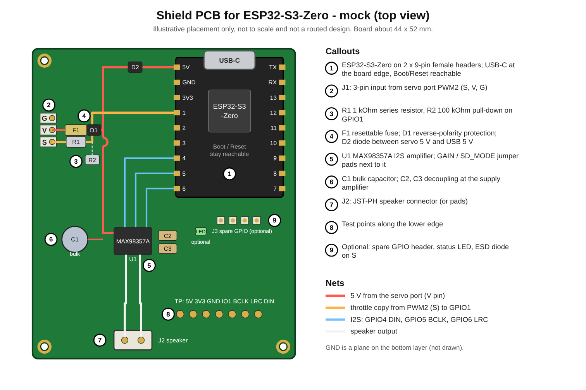

# Shield PCB (iteration 2): scope

Status: requirements only, no schematic yet. The prototype (iteration 1) is a breadboard with an ESP32-S3-Zero-N8R8-M and a MAX98357A, powered and verified as described in `bringup.md`.

## Rule: PWM2 is dedicated to the sound module

The throttle is copied to the servo port **PWM2** in the CyberBrick app (L Stick Y drives both Throttle on M1 and PWM2). The module only listens to that copy and takes its power from the same port:

- S: throttle copy, 50 Hz, about 3.3 V, 977..1973 us (45..135 deg), centre about 1455 us
- V: about 4.94 V without load; the module draws about 57 mA idle and 105 mA at full throttle (`MASTER_VOLUME` 0.6, 40 mm speaker)
- G: ground

Nothing else can be connected to PWM2: a servo there would follow the throttle. The original path to the motor (port M1) is untouched, so **the board needs no pass-through connector**. PWM1 (steering), PWM3 and PWM4 stay free.

## On the board

Mock of the layout (top view, illustrative placement, not routed; source `shield-mock.svg`).

1. **Socket or pads for the ESP32-S3-Zero**, same pin use as the prototype: GPIO1 throttle in, GPIO4 I2S DOUT, GPIO5 BCLK, GPIO6 LRC. The USB-C port and the Boot/Reset buttons must stay reachable for flashing.
2. **Input connector** (3-pin servo type: S, V, G) to PWM2. S goes through a 1 kOhm series resistor to GPIO1, optionally with a large pull-down (for example 100 kOhm) so the input is defined when disconnected, and optionally an ESD/TVS device.
3. **Power from the servo port**: reverse-polarity protection (Schottky diode or P-MOSFET), a resettable fuse, a bulk capacitor (about 100-470 uF) near the amplifier and small ceramic decoupling capacitors. A diode (or ideal diode) between the servo-port 5 V and the USB 5 V so both can be connected at the same time; on the breadboard only one of them may ever be connected.
4. **MAX98357A amplifier**: gain and shutdown/channel pins configurable (resistors or jumpers), speaker output to a connector (for example JST-PH) or solder pads. The chip is hard to solder by hand; assembly by a PCB service is likely.
5. **Service items**: test points (5 V, 3.3 V, GND, GPIO1, I2S lines), mounting holes, optionally a status LED and spare GPIOs broken out for later inputs (for example a switch to trigger an engine stop sound).

## Decisions still open

- Amplifier as a chip on the board or as a plug-in breakout module.
- Board size and placement in the model, and the speaker it has to carry (40 mm or a production candidate; see `sound-research.md`).
- ESP32-S3-Zero in a socket (replaceable) or soldered directly.
- Hand-soldered or assembled by a PCB service.

## Out of scope for this iteration

- ESP32 module directly on the board without the Zero (iteration 3, only if size or cost demands it).
- Further sound features beyond the current firmware.

## Possible future variant: classic RC receiver

On a classic RC model the receiver drives the ESC with a servo-type signal, so a module would sit between receiver and ESC: read the signal, play the sound and pass the signal on unchanged. That needs a different board (input from the receiver, output to the ESC, a pass-through path that never interferes). It is **not** needed for CyberBrick and is not planned now.

Before such a variant, the signals of the target receiver would have to be measured, because they are more varied than the CyberBrick servo port: signal level (3.3 V or 5 V), pulse range and neutral point of the throttle channel, frame rate (50 Hz up to several hundred Hz for some receivers), behaviour at failsafe and whether the ESC's BEC powers the receiver (and so whether the module may take power from it). The firmware's pulse constants in `config.h` would then be re-derived from those measurements.

## Component list (draft, independent of how the board is assembled)

Part numbers are examples to be checked when the schematic is drawn; values marked "check" depend on a datasheet detail not yet verified.

| Group | Component | Qty | Notes |
|---|---|---|---|
| Controller | Waveshare ESP32-S3-Zero-N8R8-M | 1 | as on the prototype |
| | 2.54 mm female header, 9 pins | 2 | one per long edge of the Zero (5V, GND, 3V3, 1..6 and TX, RX, 13..7); omit if the Zero is soldered directly |
| Amplifier | MAX98357AETE+ (I2S class-D amp, TQFN-16 3x3 mm) | 1 | alternative: MAX98357AEWL+ (WLP-9), smaller but harder to route; or a plug-in breakout module instead of the chip |
| | Decoupling for the amp supply: 10 uF + 100 nF ceramic, close to VDD | 1 + 1 | |
| | Bulk capacitor 100-470 uF, 10 V (polymer or electrolytic) | 1 | near the amplifier supply |
| | GAIN and SD_MODE configuration: solder-jumper pads and 100 kOhm resistors | 2-3 | default GAIN open = 9 dB; the SD_MODE resistor values that give (L+R)/2 are to be checked in the datasheet (the firmware sends the same sample on both channels) |
| | Optional 22-33 Ohm series resistors on BCLK, LRC, DIN | 3 | EMI damping; can be 0 Ohm |
| | Optional ferrite beads and small capacitors on the speaker outputs | 2 + 2 | only if EMI becomes a problem with longer speaker wires |
| Speaker | JST-PH 2-pin connector (for example S2B-PH-K or B2B-PH-K) + mating cable | 1 | or two solder pads |
| Input | 3-pin 2.54 mm pin header (S, V, G) | 1 | mates with a 3-pin female servo/Dupont cable to PWM2 (check the orientation against the receiver's header) |
| | Resistor 1 kOhm | 1 | series resistor S to GPIO1 |
| | Resistor 100 kOhm | 1 | pull-down on GPIO1 (defined level when the cable is unplugged) |
| | ESD/TVS diode, low capacitance (optional) | 1 | on the S line |
| Power | Resettable fuse (PTC), about 0.5 A hold | 1 | the module draws about 0.1 A average |
| | Reverse-polarity protection: Schottky diode (for example SS14) or P-MOSFET | 1 | a Schottky drops about 0.3-0.4 V, which is acceptable at this current (the amplifier needs 2.5-5.5 V) |
| | Diode (or ideal diode) between servo 5 V and USB 5 V | 1 | so both can be connected; check first whether the Zero's 5V pin already has a diode towards USB |
| | Ceramic capacitors 100 nF | 2-3 | general decoupling |
| Service | Test points (5 V, 3.3 V, GND, GPIO1, BCLK, LRC, DIN) | 7 | 1 mm pads |
| | Status LED + 1 kOhm resistor (optional) | 1 + 1 | |
| | Spare GPIO header 1x4 (optional) | 1 | for later inputs, for example a switch for an engine-stop sound |
| Mechanical | M2 mounting holes | 2-4 | position depends on the space in the model |
