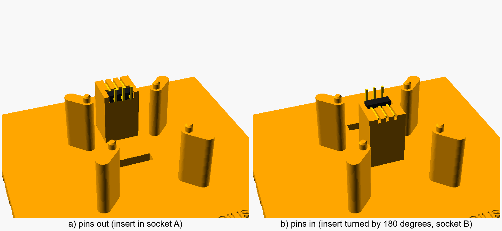
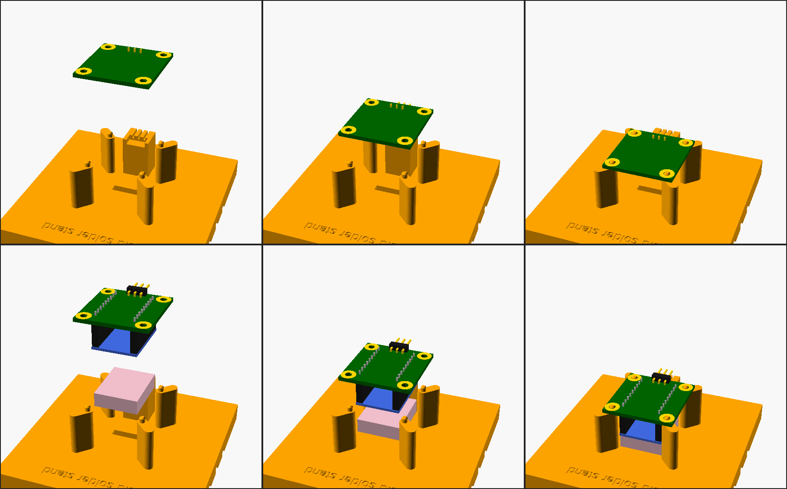
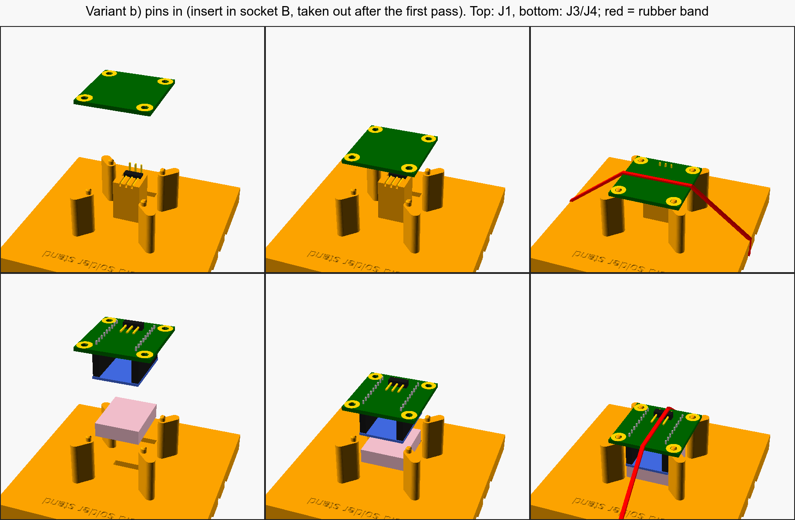

# Soldering the shield board and the printed stand

How the hand-fitted parts of the shield board (`hardware/shield/`) are soldered, and the printed stand that holds the board
for it (`hardware/solder_stand/`). The board itself, the connectors and the open points are in `docs/shield-pcb.md`.

## What is soldered by hand

The other parts of the board come assembled (JLCPCB). Three parts are fitted by hand:

| Part | What it is | Where |
|---|---|---|
| J3, J4 | two female socket strips 1x9, 8.5 mm body (for the ESP32-S3-Zero) | top side of the board |
| J1 | right-angle servo header 1x3 | **always the underside** of the board |

J1 is on the underside in both ways of fitting it, because the top side is full of parts. The two ways:

- **Variant a): the pins out.** The body of J1 is at the edge of the board and the long pins (the servo plug) stick out
  beyond the edge.
- **Variant b): the pins in.** J1 is turned by 180 degrees: the body is on the inner side of the row of holes and the plug
  is entirely under the board.

J1 on the top side is not tried in the stand and in practice it is excluded (the parts are there).

## The stand

One printed base with four posts, one loose insert for J1 and rubber bands.

| File | What it is |
|---|---|
| `hardware/solder_stand/solder_stand.scad` | the model (OpenSCAD); the header comment describes the use and the export commands |
| `solder_stand.stl`, `solder_stand_j1_insert.stl` | the base and the insert (generated, not committed) |
| `tools/make_stand_3mf.py` | puts both parts on one plate in a 3MF (the insert lying on its back) |

- **Base:** 80 x 80 mm, 8 mm thick, four posts 18 mm tall with locating pins for the mounting holes of the board (the board
  rests on the copper rings), a pocket for the Zero and the foam, and grooves in the underside for the rubber bands. Two sockets for the
  insert, mirror images about the row of J1's holes: **socket A** outside the board edge (variant a) and **socket B** under
  the board (variant b).
- **Insert:** a ledge under the body of J1, guides at both ends of the body, a comb with a slot for each long pin, and a peg
  that goes into the socket. In socket B it is turned by 180 degrees.
- **Print:** PLA or PETG, 0.2 mm layers, the base flat on the bed, the insert lying on its back. **Bridge direction 45 degrees**
  (Bambu Studio, Advanced; the default is automatic), because of the rubber band grooves: they run both ways under the base,
  and 45 degrees bridges across both.
- **Rubber bands:** one band of about 3 mm round the stand; it sits in the middle groove of the base.

The third iteration (the base with the two sockets and the loose insert) was printed and works (2026-11-23), tried with J1
on the underside of the board. Variant b) has been drawn and checked in the model, but the physical trial of each variant
separately is not recorded.

## Procedure

Variant a) is **one pass** and was tried on the printed stand (2026-11-23, photos from the soldering). J1, J3, J4 and the Zero are all on
the same side of the board, the one facing the stand, and everything is soldered from the visible side. Variant b) is still described as
two passes; it has not been checked against photos yet.

### Variant a): the pins out (insert in socket A), one pass

1. Put the insert into socket A, outside the board edge. It stays there for the whole soldering and does not obstruct fitting the Zero.
2. Lay J1 on the insert: the body on the ledge, the long pins (the servo plug) in the slots of the comb, pointing out, the short pins up.
3. Plug both 1x9 socket strips onto the pins of the ESP32-S3-Zero-N8R8-M. The Zero keeps them parallel and at the right spacing
   (15.24 mm). Put a piece of soft foam into the pocket of the stand.
4. Put the board with the Zero on the posts: the locating pins go into the mounting holes, the pins of J1 come through its holes, the
   Zero sinks into the pocket and the foam presses it, and so the sockets, against the board.
5. Put the **rubber band** lengthwise: from the edge of the base over the board between the pins of J1 and over the comb of the insert,
   along the board between the two rows of the strips, and back under the base through the middle groove. Hold the board with it
   and solder one pin at each end of every strip, check that everything sits flat, then solder the rest of J3 and J4.
6. **Move the rubber band** across the board (lengthwise it lies over the pads of J1), and solder the three pins of J1.

### Variant b): the pins in (insert in socket B, turned by 180 degrees), two passes

Checked against photos of the soldering (2026-11-23). J1 is on the opposite side of the board from the strips and the Zero, so the board is turned over between the passes.

First pass, J1:

1. Put the insert into socket B, turned by 180 degrees, under the board.
2. Lay J1 on the insert, turned by 180 degrees as well: the body on the ledge, the long pins in the slots of the comb (they point into the board), the short pins up.
3. **Hold the pins of J1 in place by hand**, and only then put the board on the posts with the **side with the components up** (no Zero, no foam). The short pins go through the holes of J1.
4. Put the rubber band across the board, and solder J1 from the visible side. Then **take the insert out** of socket B.

Second pass, J3 and J4:

1. Plug both 1x9 socket strips onto the pins of the Zero, and put the foam into the pocket.
2. Put the board on the posts **turned over** (the soldered side with the J1 body up, the Zero and the strips below it).
3. Put the rubber band lengthwise, over the body of J1 between its pins. Solder one pin at each end of every strip, check that everything sits flat, then solder the rest of J3 and J4.

## Notes

- The stack height of the Zero (the socket 8.5 mm, its header and its own parts) was not measured; the foam takes up the
  difference, and the posts only have to be taller than the stack.
- The stand is symmetric about the long axis of the board, so it does not matter that the board lies mirrored.
