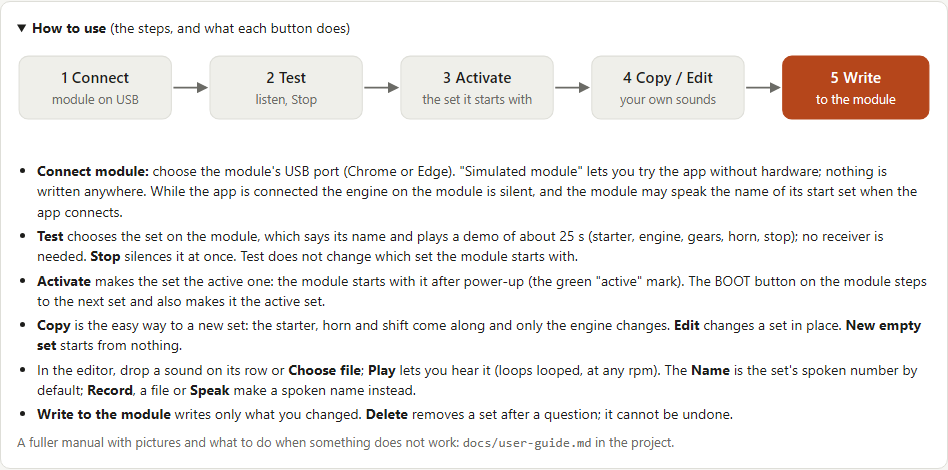
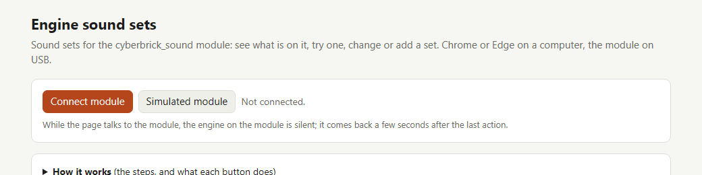
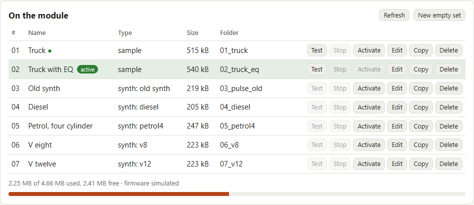
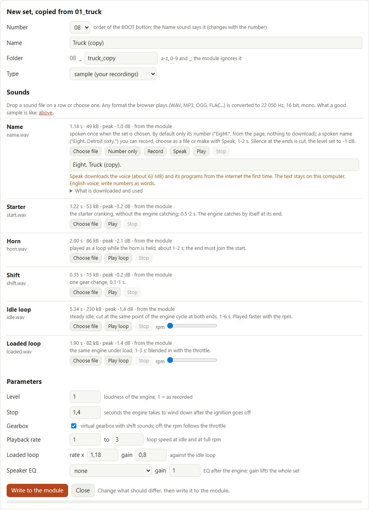
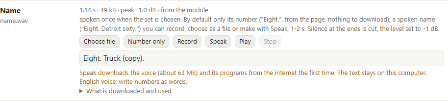

# Engine sound sets: user guide

How to see, try, change and add the engine sounds of the cyberbrick_sound module with the web app
(`web/index.html`, a web app). The pictures are made by `tools/make_guide_images.py` from the app's simulated module, so they
can be remade after any change of the app. How the sets and the protocol work inside: `user-sounds.md`.

## What you need

- A computer with **Chrome or Edge** (version 89 or newer; Windows, macOS, Linux or ChromeOS). Safari, Firefox and
  browsers on phones and tablets have no Web Serial, so the app cannot reach the module there.
- The module with the **`engine_sets` firmware**, connected to the computer with a USB-C cable.
- Open `web/index.html` in the browser (from disk, or from a web server when the project publishes it).

## The steps

1. **Connect** the module. 2. **Test** the sets you have. 3. **Activate** the one you want. 4. **Copy** or **Edit** a set to
make your own. 5. **Write** it to the module.

## 1. Connect

Press **Connect over USB** and choose the module's USB port in the browser's list (on Windows it is named like
"USB Serial Device (COM5)"). When it works the line next to the button reads "Connected, firmware 0.1.0+..., built
..." and the list of sets appears. The firmware version is also under the list.

**Over Bluetooth** (without a cable, with the module in the model): switch the receiver on and listen: the module says a beep and
a four digit PIN, twice. Press **Connect over Bluetooth**, choose `CBSound` and enter the PIN. You can connect for 3
minutes after the power-up. After you have written or deleted a set the module restarts and Bluetooth stays off until you
switch the receiver off and on again. Needs Chrome or Edge with Bluetooth in the computer. USB works at any time.

The PIN is made only of the digits 0, 1, 2, 3, 4, 6 and 8: the digits 5, 7 and 9 are hard to tell apart on the small speaker
(five and nine rhyme, six and seven begin alike) and are therefore not used. If you do not catch the PIN, switch the
receiver off and on again, or connect from the page and the module says it again.

**Simulated module** lets you try the whole app without hardware: it holds the default sets, everything works, and
nothing is written anywhere. Changes are gone when you close the app.

While the app is connected the engine on the module is **silent** and the BOOT button does nothing; the engine
comes back a few seconds after your last action. The module may restart when the app connects, and then speaks the
number of the set it starts with: that is normal.

### Update the firmware

The button **Update firmware** (above the list of sets) writes a new firmware to the module, over USB or over Bluetooth, whichever you are connected by. Choose
the file `firmware.bin` that `pio run -e engine_sets` makes (`firmware/.pio/build/engine_sets/firmware.bin`). The page checks it, asks, shows the progress (about
30 s over USB, about a minute over Bluetooth) and the module restarts with it. The sets in the module stay. If a new firmware does not start, the module can only
be fixed over USB: `pio run -e engine_sets -t upload`.

## 2. The list of sets

Each row is one set: its number (the order of the BOOT button), name, type, size and folder. Under the list: the used
and free memory of the module (about 4.6 MB of sounds in all) and the firmware version.

| Button | What it does |
|---|---|
| **Test** | The module chooses this set, says its name and plays a demo of about 25 s: the starter, the engine catching, full throttle through the gears, a release, two blips, the horn and the stop. No receiver is needed. It does **not** change which set the module starts with. (Synth sets cannot be tested in the simulated module, only on the real one.) |
| **Stop** | Silences the test at once. |
| **Activate** | Makes this the **active** set, the one the module **starts with** after power-up (the row is tinted and has the green "active" mark). The BOOT button on the module also steps to the next set and makes it the active set. |
| **Edit** | Opens the set in the editor to change it in place. |
| **Copy** | Opens a copy as a new set, the easy start for your own: the starter, the horn and the shift sound come along and you change only the engine. |
| **Delete** | Removes the set from the module after a question. It cannot be undone. |
| **New empty set** | A set from nothing (you have to give it every sound). |
| **Refresh** | Reads the module again. |

The small green dot after a name means that this set is the one chosen on the module right now.

## 3. Your own set

Open **Copy** (or **New empty set**, or **Edit**). In the editor:

- **Number**: the place in the order of the BOOT button; only the free numbers are offered.
- **Name**: what the app shows. The folder name is made from it and can be changed.
- **Type**: **sample** (your recordings: an idle loop and a loaded loop, played faster with the throttle) or
  **synth** (one of the firmware's synthesised engines with its preset). Everything else (starter, horn, shift,
  name) works the same in both.
- **Sounds**: drop a sound file on its row, or press **Choose file**. Any format the browser can play (WAV, MP3, OGG,
  FLAC, M4A, any rate, stereo or mono) is converted to what the module needs (22 050 Hz, 16 bit, mono). **Play**
  lets you hear it; loops play looped and, for the engine loops, at any rpm of the slider. The app warns about a
  length outside the usual range, clipping and a very quiet sound. What makes a good loop: the part "What a good
  sample is like" on the app.
- **Parameters**: loudness, the wind-down time after the ignition goes off, the virtual gearbox, the playback rate
  range, the loaded loop's speed and gain, and the **speaker EQ** (none, the one tuned for the 30 ml box, or the
  one already in the set).

Then **Write to the module**. Only the changed sounds are written, so a small edit is quick. When it is done the
set is in the list; use **Test** to hear it on the module.

## 4. The name of a set

The name is spoken once, when the set is chosen. **By default it is only the number** ("Eight."), taken from the app,
with nothing to download, and it changes by itself when you change the number. For a spoken name there are three
ways, all in the Name row:

- **Record**: say it into the microphone (the app cuts the silence and sets the level).
- **Choose file**: a recording you made elsewhere.
- **Speak**: type the text ("Eight. Detroit sixty.") and the app makes it with the Piper voice. The first time it
  **downloads** the voice (about 63 MB) and its programs from the internet, after asking; the text stays on your
  computer. English; write numbers as words. The part "What is downloaded and used" under the box names the
  projects and their licences.

A name you made yourself is **not** replaced when you change the number, and it says the old number. Make it again,
or press **Number only** to go back to the plain number. A **copy** of a set also keeps the name sound of the
original: press **Number only** (or make a new name) so that it says its own number.

## When something does not work

| What you see | What to do |
|---|---|
| "This app needs Chrome or Edge on a computer." | Open the app in Chrome or Edge on a computer. |
| The module is not in the list of ports | Check the cable (some are charge-only) and try another USB port. |
| "No port chosen." | You closed the list without choosing; press Connect over USB again. |
| The port cannot be opened | Another program or browser tab holds it (a serial monitor, an upload from PlatformIO, a second copy of the app). Close it, then connect again. The same applies the other way: flashing the firmware from the computer fails while the app is connected, so press Disconnect first. |
| "the module does not answer (is the engine_sets firmware on it?)" | The module has another firmware. Flash `engine_sets` (`pio run -e engine_sets -t upload`, and `-t uploadfs` for the default sets), see `user-sounds.md`, "Trying it". |
| "Not enough room" | Delete a set you do not need, or use shorter sounds. A set takes about 0.2-0.6 MB. |
| A write stops half way | Press Write to the module again; the file is replaced only when it has arrived whole. |
| Speak does not work | It needs the internet and a browser that can run it (Chrome, Edge). Without it use Number only, Record or Choose file. |
| The module speaks a set name when the app connects | Normal: the module restarts when the port is opened and says the number of the set it starts with. |

## What is not in the app yet

Checking whether the module's firmware is the newest, and updating it from the app (planned, see `roadmap.md`),
and help with finding the loop points of a recording.
